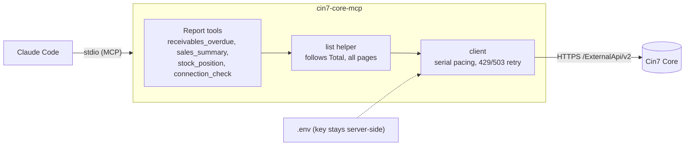

# cin7-core-mcp

A read-only [MCP](https://modelcontextprotocol.io) server that lets Claude Code answer business questions about a [Cin7 Core](https://www.cin7.com/) (formerly DEAR Inventory) account: overdue receivables, sales summaries, stock value and health, order status and the open-orders pipeline. Status: **MVP plus wave 2, sandbox only**.

## The problem

Cin7 Core's REST API is a record store, not a reporting API. Getting an answer out of it is harder than it looks:

- **No aggregate or reporting endpoints.** Totals, margins, valuation and "what is overdue" must be computed client-side.
- **List endpoints return headers only.** Line-level questions need one detail call per record, under a limit of **60 calls/min per key** (173 sales is about 3 minutes; larger accounts far more).
- **Definition traps** that give plausible but wrong numbers: `InvoiceAmount` is *net of credit notes*, `StockOnHand` is a *value* not a unit count, paging defaults to 100 rows, Advanced and Simple sales roll their statuses up differently, "today" depends on the tenant time zone.
- **Reporting limits are a recurring ERP complaint** (see [`docs/research/user-complaints.md`](docs/research/user-complaints.md)).

A capable Claude Code session can already call the API with Bash and the key, but it re-derives these rules each time, sometimes gets them wrong, and needs the API key in its environment.

## Proposed solution

Outcome-oriented tools, not an endpoint wrapper. Each tool answers a business question with a small aggregate, bakes in the correct definitions (stated in the tool description and in every result), paces and retries requests against the rate limit, and keeps the API key out of the model's context.



### Does it actually help? (evaluation, 2026-11-05)

A/B test: Claude Code + Bash + the key (baseline) vs the same with this MCP, 5 in-scope questions, 2 runs each, answers graded against an independent ground-truth script.

| | Baseline | MCP |
|---|---|---|
| Correct | 8 / 10 | **10 / 10** |
| Cost | 1.8x | 1x |
| Time | 2.5x | 1x |
| API key reachable by the model | yes | no |

The baseline's misses were the gross-vs-net invoice trap. Savings are small in absolute terms (about a cent and a few seconds per question), the sample is small, and the same author wrote tools and questions. A narrow MCP also cannot answer questions outside its tools (the MCP arm declined an out-of-scope purchase-order question; the baseline queried the API). A second wave (7 tools, 30 runs) came out 15/15 vs 12/15 correct, baseline 1.4x cost and 2.1x time; part of the gap is a definition ambiguity rather than a hard error, and the master-status trap itself did not separate the arms. Full numbers and caveats: [`docs/research/mvp-evaluation.md`](docs/research/mvp-evaluation.md); decisions in [ADR 0003](docs/adr/0003-read-only-reports-mvp.md) and [ADR 0004](docs/adr/0004-pii-safe-shaping-and-stage-derivation.md).

A third wave asked for revenue by SKU on a document basis, a question that needs the whole sale-detail fan-out: the cache-backed tool was correct cold (169 s, first load) and warm (7 s); the baseline was wrong in both runs (299 s and 380 s). Details in `docs/research/mvp-evaluation.md` and [ADR 0005](docs/adr/0005-line-level-snapshot-cache.md).

## Tools (all read-only)

| Tool | Inputs | Answers |
|---|---|---|
| `cin7_connection_check` | none | Credentials work; company, currency, time zone |
| `receivables_overdue` | `asOf?` (yyyy-MM-dd, default today in tenant zone), `topN?` | Outstanding and overdue invoice balances, age buckets (1-30, 31-60, 61-90, 90+), largest overdue balances |
| `sales_summary` | `groupBy` (`month` / `channel` / `customer`), `from?`, `to?`, `topN?` | Invoiced revenue and sale counts, net of credit notes, voided sales excluded; omit dates for all time |
| `stock_position` | `location?`, `topN?` | Stock value and units by location, top products by value, count of negative-available stock |
| `order_lookup` | `orderNumber` | One sale by exact order number: stage (from sub-statuses), capped lines, fulfilment, invoices. **Personal contact data is dropped** (allow-list shaping) |
| `open_orders_pipeline` | `includePurchases?` | Open sales by workflow stage, stuck counts (awaiting pick / ship / invoice / payment), purchase orders awaiting receipt, and how many sales the master status misdescribes |
| `stock_health` | `topN?`, `includeReorder?` | Negative available stock, on-order-with-nothing-on-hand, products at or below their reorder point, availability formula mismatches (reads the product list: about 2 large calls) |
| `sales_by_sku` | `from?`, `to?`, `topN?`, `sortBy?`, `refresh?`, `maxMinutes?` | Revenue (ex-tax), quantity, cost and margin by SKU from the **line-level cache**, attributed by invoice or credit-note date. May warm the cache (about 1.1 s per invoiced sale); states coverage and returns `complete: false` while the window is not fully loaded |
| `cache_refresh` | `windowDays?` (or `all`), `full?`, `maxMinutes?` | Loads or refreshes the local snapshot: lists headers, fetches details only for changed sales, resumable at a time budget, progress notifications |
| `cache_status` | none | Local cache only (no Cin7 calls): size, last sync, window, pending details and a rollup-drift summary (Cin7 list totals vs invoice and credit-note documents) |

Not built yet (prioritised in [`docs/research/prioritisation.md`](docs/research/prioritisation.md)): explanations for negative stock, sales velocity and reorder suggestions, and any write operations.

## Tech

- **TypeScript** on Node 22+, ESM; official **MCP SDK v2** (`@modelcontextprotocol/server`), **Zod v4** schemas for tool input and output ([ADR 0002](docs/adr/0002-typescript-mcp-sdk-v2.md)).
- **stdio** transport (local Claude Code); native `fetch` for Cin7; no database or cache yet.
- Tooling: vitest (unit tests with synthetic fixtures), Biome (lint and format), `tsc`, npm.
- Implementation of individual tools is delegated to Haiku agents and reviewed (see `CLAUDE.md`).

## Setup

```bash
npm install
cp .env.example .env    # CIN7_ACCOUNT_ID, CIN7_APPLICATION_KEY, CIN7_BASE_URL (API root, no /v2)
npm run build
npm test                # typecheck, lint: npm run typecheck && npm run lint
```

The server loads the repo-root `.env` itself (path resolved from the script, so the launch directory does not matter) and appends `/v2` to `CIN7_BASE_URL`. Optional: `CIN7_CACHE_DIR` for the line-level cache location.

### Use with Claude Code
`.mcp.json` registers the server for this repo. Project-scoped servers need a one-time approval: run `claude` in the repo and accept it (check with `claude mcp list`). For other clients:

```json
{
  "mcpServers": {
    "cin7-core": { "command": "node", "args": ["/absolute/path/to/mcp7/dist/index.js"] }
  }
}
```
Debug with `npm run inspect`. Re-run the evaluation after changing tools: see [`eval/README.md`](eval/README.md) (about 24 headless Claude runs; real API spend).

## Limitations

- **Sandbox only.** Built and tested against a Cin7 sandbox, which is small and synthetic. Production scale is untested.
- **Personal data:** `order_lookup` uses allow-list shaping (no contact person, email, phone, addresses or free-text notes) and caps lines. Other tools return aggregates but can include customer business names. There is no global response-size budget yet.
- **Line-level cache (ADR 0005).** `sales_by_sku` reads a local snapshot under `.cache/cin7` (override with `CIN7_CACHE_DIR`; gitignored). It holds business names, order lines and money, no contact data. First load is about 1.1 s per invoiced sale (about 160 s for the sandbox's 147), then refreshes are incremental. Revenue is a **document basis** (authorised invoices minus credit notes, ex-tax, by document date), unlike the older tools' list rollups. Results are labelled partial until the window is fully loaded.
- **Read-only.** Nothing writes to Cin7.
- **Rate limit.** Requests are serialised at about 1 per 1.1 s; the key is shared with anyone else using it.

## Docs

[`docs/README.md`](docs/README.md) indexes the research (Cin7 API reference, MCP landscape, user complaints, sandbox findings, prioritisation, evaluation), design sketches (mermaid), ADRs and glossary. [`CLAUDE.md`](CLAUDE.md) holds working conventions.

Licensed under Apache-2.0.
