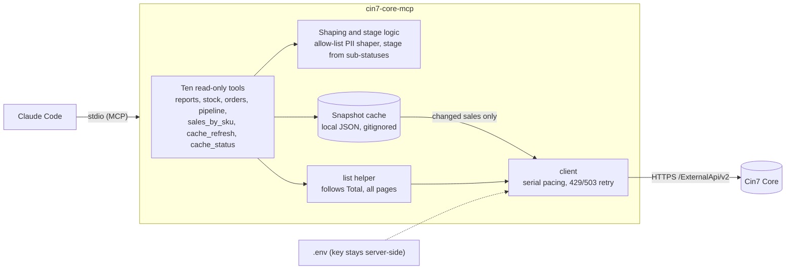

# cin7-core-mcp

A read-only [MCP](https://modelcontextprotocol.io) server that lets Claude Code answer business questions about a [Cin7 Core](https://www.cin7.com/) (formerly DEAR Inventory) account: overdue receivables, sales summaries, stock value and health, order status and the open-orders pipeline. Status: **ten tools, line-level cache, sandbox only**; see [Project status and how to resume](#project-status-and-how-to-resume).

## The problem

Cin7 Core's REST API is a record store, not a reporting API. Getting an answer out of it is harder than it looks:

- **No aggregate or reporting endpoints.** Totals, margins, valuation and "what is overdue" must be computed client-side.
- **List endpoints return headers only.** Line-level questions need one detail call per record, under a limit of **60 calls/min per key** (173 sales is about 3 minutes; larger accounts far more).
- **Definition traps** that give plausible but wrong numbers: the list rollups (`InvoiceAmount`, documented as net of credit notes) can disagree with the invoice and credit-note documents (about 30% of sandbox sales), `StockOnHand` is a *value* not a unit count, paging defaults to 100 rows, Advanced and Simple sales roll their statuses up differently, "today" depends on the tenant time zone.
- **Reporting limits are a recurring ERP complaint** (see [`docs/research/user-complaints.md`](docs/research/user-complaints.md)).

A capable Claude Code session can already call the API with Bash and the key, but it re-derives these rules each time, sometimes gets them wrong, and needs the API key in its environment.

## Proposed solution

Outcome-oriented tools, not an endpoint wrapper. Each tool answers a business question with a small aggregate, bakes in the correct definitions (stated in the tool description and in every result), paces and retries requests against the rate limit, and keeps the API key out of the model's context.



### Does it actually help? (three evaluation waves, 2026-11-05 to 2026-11-06)

A/B test: Claude Code + Bash + the key (baseline) vs the same with this MCP. Questions, alternative readings and a kill criterion were pre-registered; ground truth is computed independently of `src/`; same model and permissions in both arms.

| Wave | Questions | Result | What it shows |
|---|---|---|---|
| 1 | Q1 to Q5, 20 runs | MCP 10/10, baseline 8/10; baseline 1.8x cost, 2.5x time | agreement with Cin7 list-rollup definitions (see the correction below) |
| 2 | Q6 to Q10 plus regression, 30 runs | MCP 15/15, baseline 12/15; baseline 1.4x cost, 2.1x time | the Q6 gap is a definition ambiguity; the master-status trap did not separate the arms |
| 3 | Q11 revenue by SKU on documents, 4 runs | MCP correct cold (169 s, first load) and warm (7 s); baseline wrong twice (299 s, 380 s) | the question that needs the whole sale-detail fan-out; first document-basis truth |
| 4 | Q1 to Q3 re-graded on a document-basis truth, 6 runs (1 per arm, about 0.28 US dollars) | treatment 3/3 correct, baseline 0/3 (two wrong, one on the list-rollup reading); treatment not faster on Q2 and Q3 (cold cache load each run) | n = 1 per cell, a sanity check after the tools moved to the document basis (ADR 0006) |

**Correction (merged in #15):** in waves 1 and 2, "correct" meant agreement with Cin7's list rollups (`InvoiceAmount` and friends), which differ from the invoice and credit-note documents on about 30% of sandbox sales. On documents neither arm matched Q1 (43 overdue sales versus 29), and on Q2 and Q3 the baseline was closer than the older tools. Those two tools (`receivables_overdue`, `sales_summary`) still read the list rollups and say so; moving them to the cache's document basis is the next planned step. Caveats: small samples, the same author wrote tools, questions and truth, the sandbox is small and synthetic, and a narrow MCP cannot answer questions outside its tools (the MCP arm declined an out-of-scope question; the baseline queried the API). Full numbers: [`docs/research/mvp-evaluation.md`](docs/research/mvp-evaluation.md); decisions: [ADR 0003](docs/adr/0003-read-only-reports-mvp.md), [ADR 0004](docs/adr/0004-pii-safe-shaping-and-stage-derivation.md), [ADR 0005](docs/adr/0005-line-level-snapshot-cache.md).

## Tools (read-only against Cin7; `cache_refresh` writes only the local cache file)

| Tool | Inputs | Answers |
|---|---|---|
| `cin7_connection_check` | none | Credentials work; company, currency, time zone |
| `receivables_overdue` | `asOf?` (yyyy-MM-dd, default today in tenant zone), `topN?`, `refresh?`, `maxMinutes?` | Outstanding and overdue balances on the document basis (invoices minus paid minus credit notes, from the cache), age buckets (1-30, 31-60, 61-90, 90+), largest overdue balances, plus the un-netted and old list-rollup figures |
| `sales_summary` | `groupBy` (`month` / `channel` / `customer`), `from?`, `to?`, `topN?`, `dateBasis?`, `refresh?`, `maxMinutes?` | Revenue (ex-tax and inc-tax, invoices minus credit notes, from the cache) and sale counts, voided sales excluded; `dateBasis` `document` (default) or `order`; omit dates for all time; the old list-rollup figure is returned alongside |
| `stock_position` | `location?`, `topN?` | Stock value and units by location, top products by value, count of negative-available stock |
| `order_lookup` | `orderNumber` | One sale by exact order number: stage (from sub-statuses), capped lines, fulfilment, invoices. **Personal contact data is dropped** (allow-list shaping) |
| `open_orders_pipeline` | `includePurchases?` | Open sales by workflow stage, stuck counts (awaiting pick / ship / invoice / payment), purchase orders awaiting receipt, and how many sales the master status misdescribes |
| `stock_health` | `topN?`, `includeReorder?` | Negative available stock, on-order-with-nothing-on-hand, products at or below their reorder point, availability formula mismatches (reads the product list: about 2 large calls; Service and deprecated products are excluded from the reorder check) |
| `sales_by_sku` | `from?`, `to?`, `topN?`, `sortBy?`, `refresh?`, `maxMinutes?` | Revenue (ex-tax), quantity, cost and margin by SKU from the **line-level cache**, attributed by invoice or credit-note date. May warm the cache (about 1.1 s per invoiced sale); states coverage and returns `complete: false` while the window is not fully loaded |
| `reorder_suggestions` | `windowDays?`, `leadTimeDays?` (default 14), `targetCoverDays?` (default 30), `asOf?`, `topN?`, `refresh?`, `maxMinutes?` | Which products to reorder: net units sold per day (invoices minus credit notes, from the cache) against current stock and Cin7 reorder thresholds; days of cover, stock-out-before-delivery flag and a suggested quantity under the stated lead-time and cover assumptions |
| `cache_refresh` | `windowDays?` (or `all`), `full?`, `maxMinutes?` | Loads or refreshes the local snapshot: lists headers, fetches details only for changed sales, resumable at a time budget, progress notifications |
| `cache_status` | none | Local cache only (no Cin7 calls): size, last sync, window, pending details and a rollup-drift summary (Cin7 list totals vs invoice and credit-note documents) |

Not built yet (prioritised in [`docs/research/prioritisation.md`](docs/research/prioritisation.md)): explanations for negative stock and any write operations. This iteration is read-only against Cin7 by decision.

## Tech

- **TypeScript** on Node 22+, ESM; official **MCP SDK v2** (`@modelcontextprotocol/server`), **Zod v4** schemas for tool input and output ([ADR 0002](docs/adr/0002-typescript-mcp-sdk-v2.md)).
- **stdio** transport (local Claude Code); native `fetch` for Cin7; no database, but a local JSON snapshot cache for line-level data ([ADR 0005](docs/adr/0005-line-level-snapshot-cache.md)). Streamable HTTP is deferred (ADR 0002).
- Decisions are recorded as ADRs: [0001](docs/adr/0001-record-architecture-decisions.md) process, [0002](docs/adr/0002-typescript-mcp-sdk-v2.md) stack, [0003](docs/adr/0003-read-only-reports-mvp.md) reports MVP, [0004](docs/adr/0004-pii-safe-shaping-and-stage-derivation.md) PII shaping and stage derivation, [0005](docs/adr/0005-line-level-snapshot-cache.md) line-level cache, [0006](docs/adr/0006-document-basis-reports.md) document-basis receivables and sales summary, [0007](docs/adr/0007-velocity-and-reorder-suggestions.md) velocity and reorder suggestions.
- Tooling: vitest (unit tests with synthetic fixtures), Biome (lint and format), `tsc`, npm.
- Implementation of individual tools is delegated to Haiku agents and reviewed (see `CLAUDE.md`).

## Getting started

**You need:** Node 22 or later (`.nvmrc` pins 22; `nvm use` picks it up), npm, git, the [Claude Code](https://claude.com/claude-code) CLI, and a Cin7 Core account with an API application (use a sandbox or test account: this project was built and tested against one).

### 1. Clone and install
```bash
git clone git@github.com:LiamB299/mcp7.git      # or: https://github.com/LiamB299/mcp7.git
cd mcp7
npm install
npm run build        # compiles to dist/ (gitignored: rebuild after every pull)
npm test             # 308 tests, no network, no credentials needed
```

### 2. Add your Cin7 credentials
Create an API application in Cin7 Core (the "API setup" page in the app, `https://inventory.dearsystems.com/ExternalAPI`; menu names can differ by version) and copy its **Account ID** and **Application Key**. Then:

```bash
cp .env.example .env
```
and fill in `CIN7_ACCOUNT_ID` and `CIN7_APPLICATION_KEY`. Leave `CIN7_BASE_URL` at its default (the API root without `/v2`; the server appends `/v2`). Optional: `CIN7_CACHE_DIR` moves the local cache (default `.cache/cin7`).

- `.env` is gitignored. Never commit it or paste the key into a chat.
- The server loads this `.env` itself (the path is resolved from the script, so the launch directory does not matter). The key therefore never enters Claude's context.
- Without it the server exits at start-up with "Invalid configuration" and names the missing variables.

### 3. Connect it to Claude Code
`.mcp.json` registers the server for this repo, so from the repo root:

```bash
claude               # accept the one-time prompt to approve the "cin7-core" project server
claude mcp list      # expect: cin7-core: node dist/index.js - Connected
```
Inside Claude Code, `/mcp` shows the server and its eleven tools. Start `claude` from the repo root: the entry uses the relative path `dist/index.js`. To use the server from another directory or another MCP client, register it with an absolute path:

```json
{
  "mcpServers": {
    "cin7-core": { "command": "node", "args": ["/absolute/path/to/mcp7/dist/index.js"] }
  }
}
```

### 4. Ask questions
Start with "Check the Cin7 connection" (`cin7_connection_check`: company, currency, time zone). Then plain business questions, for example:

| Ask | Tool |
|---|---|
| "Which invoices are overdue as of today, and how old are they?" | `receivables_overdue` |
| "Revenue by channel for July to September, by order date" | `sales_summary` (`dateBasis` `order`) |
| "Top 10 SKUs by revenue and margin" | `sales_by_sku` |
| "What should I reorder, assuming a 14-day lead time and 30 days of cover?" | `reorder_suggestions` |
| "Which products are negative or below their reorder point?" | `stock_health` |
| "Stock value by location" | `stock_position` |
| "How many open sales are waiting to be picked or shipped?" | `open_orders_pipeline` |
| "Show me order SO-1234 and where it is" | `order_lookup` |

Every tool states its definitions in its description and its answer, so you can ask Claude "what does that number include?".

**The first cache-backed question is slow.** `receivables_overdue`, `sales_summary`, `sales_by_sku` and `reorder_suggestions` read a local snapshot of sale details, which costs one Cin7 call per invoiced sale (about 1.1 s each: roughly 3 minutes for the sandbox's 147 sales, about 18 minutes per 1,000). It is resumable and reports progress; if an answer says `complete: false`, its totals are partial, so ask again to continue. Later questions refresh only what changed. `cache_status` shows what is cached; `cache_refresh` warms it ahead of time; deleting `.cache/cin7` rebuilds it from scratch.

### 5. Update and troubleshoot
```bash
git pull && npm install && npm run build    # then restart claude: it runs dist/, not src/
```
- **"Pending approval" or the server is missing from `claude mcp list`:** run `claude` in the repo root and accept the project-server prompt.
- **"Invalid configuration" or a 401 from Cin7:** check `.env` (account ID, key and base URL) against the API setup page.
- **Anything else:** `npm run inspect` opens the MCP Inspector on the built server; server logs go to stderr only (stdout is the protocol channel).
- **Rate limit:** Cin7 allows 60 calls per minute per key, shared with anyone else using it; the client paces requests and retries 429 and 503 automatically.
- This server **never writes to Cin7**. The cache-backed tools write one local file (`.cache/cin7`), which holds customer business names and invoice lines: keep it out of version control (it is gitignored).

**For developers:** re-run the evaluation after changing tools: see [`eval/README.md`](eval/README.md). Runs are headless Claude sessions that cost real API money (a few cents each, dozens per wave) and the revenue-by-SKU truth script makes about 165 paced Cin7 calls: state the estimate and get approval first.

## Try it: examples that show it working

Run these in Claude Code from the repo root, in this order. Each prompt can be pasted as is. The "you should see" lines are **reference numbers from the project's sandbox account** (run 2026-11-09, currency ZAR): your account will differ, but the *shape* of each answer and the checks between answers should hold. Every answer from a cache-backed tool also carries `complete: true` when all data is loaded, plus a `definition` saying exactly what the number includes.

**Fast, no cache (a few seconds each)**

1. **Connection.** *"Check the Cin7 connection."* (`cin7_connection_check`) You should see your company name, currency and time zone (sandbox: ZAR, Africa/Johannesburg). If this fails, nothing else will work: see Troubleshooting above.
2. **Stock value.** *"What is the total value of my stock and where is it held? Give me the top 3 products."* (`stock_position`) Sandbox: 2,080,603.69 across 7 locations, 141 products with stock rows, 15 negative-available rows over 9 products. The total is a **value** (on hand times average cost), not units (14,808 units); the answer says so.
3. **Stock health.** *"Give me a stock health check."* (`stock_health`) Sandbox: 9 products with negative available stock, 22 with stock on order but none on hand, 6 at or below their reorder point (3 already on order; 17 non-stock products such as services are excluded), 4 availability rows where Available is not OnHand minus Allocated.
4. **Order pipeline.** *"How many open sales are waiting to be picked or shipped, and how many purchases are waiting for goods?"* (`open_orders_pipeline`) Sandbox: 114 of 174 sales open (7 backordered), 38 of them showing a master status that hides how far along they are; 65 of 90 open purchases awaiting receipt. The stage comes from the order's sub-statuses, not Cin7's misleading master status.
5. **One order.** *"Look up order SO-1234 and tell me where it is."* (`order_lookup`) Replace the number with a real order number from your account. You should see its derived stage, lines (capped at 20) and totals, and no contact details, addresses or notes.

**Cache-backed (the first question loads the cache)**

6. **Cache status, before.** *"What is in the local cache?"* (`cache_status`) First time: `exists: false` and a note to build it. This call never touches Cin7.
7. **Overdue receivables (slow the first time).** *"Which invoices are overdue as of today and how much is owed? Show the 3 largest."* (`receivables_overdue`) Sandbox first call: about 165 seconds while it loads 147 invoiced sales (Claude may report progress). Then: 43 overdue sales worth 83,735.44, none without a due date, `complete: true`. The same answer carries `withoutCreditNetting` and `listRollup`: Cin7's own list totals said 29 overdue sales (26,447) on 2026-11-05, which is the number a naive script reports.
8. **Cache status, after.** Ask question 6 again. Sandbox: 174 sales, 147 with documents, about 178 KB, and a **rollup drift** summary: Cin7's list totals disagree with the invoice and credit-note documents on 49 of 147 sales (18 credit notes not netted, 10 showing zero despite an invoice, 21 other).
9. **Sales by month.** *"Show me sales by month."* (`sales_summary`) Answers in about a second now. Sandbox: 147 sales, 24 credit notes, revenue 123,874.48 ex-tax (134,854.52 with tax) over 18 months, and a `listRollup` block showing the old list-based total (78,586), far lower.
10. **Sales by SKU.** *"Top 3 SKUs by revenue and margin."* (`sales_by_sku`) Sandbox: revenue 111,580.08 ex-tax, cost 73,744.96, margin 37,835.12 on 409 units, with the other 32 SKUs rolled into `other`.
11. **Check that 9 and 10 agree.** Document totals include freight and other additional charges; SKU rows do not. Sandbox: 123,874.48 minus 111,580.08 is 12,294.40, exactly the `additionalCharges` figure reported by `sales_by_sku`. If your two numbers differ by that field, the tools reconcile.
12. **Reorder suggestions.** *"What should I reorder, assuming a 14-day lead time and 30 days of cover? Show the top 3."* (`reorder_suggestions`) You should see the assumptions echoed back, a 90-day sales window, days of cover and a suggested quantity per product. Sandbox: 1,610 stock products, only 3 sold in the last 90 days, 6 at or below their Cin7 reorder point and none running out within 14 days: the sandbox is too quiet to show a real replenishment picture, and the answer says why a threshold-only product shows a suggested quantity of 0.
13. **Ask Claude to explain a number.** *"What does the overdue total include, and why is it different from Cin7's own list total?"* Claude answers from the tool's `definition` text: invoices minus paid minus credit notes, tax-inclusive, with the list rollup shown as the alternative.

**Without Claude (to see the raw answers):** `npm run inspect` opens the MCP Inspector on the built server. Pick a tool and paste arguments, for example `{ "topN": 3 }` for `stock_health`, `{ "asOf": "2026-11-05", "topN": 3 }` for `receivables_overdue`, or `{ "groupBy": "month" }` for `sales_summary`.

## Limitations

- **Sandbox only.** Built and tested against a Cin7 sandbox, which is small and synthetic. Production scale is untested.
- **Personal data:** `order_lookup` uses allow-list shaping (no contact person, email, phone, addresses or free-text notes) and caps lines. Other tools return aggregates but can include customer business names. There is no global response-size budget yet.
- **Line-level cache (ADR 0005).** `sales_by_sku`, `receivables_overdue` and `sales_summary` read a local snapshot under `.cache/cin7` (override with `CIN7_CACHE_DIR`; gitignored). It holds business names, order lines and money, no contact data. First load is about 1.1 s per invoiced sale (about 160 s for the sandbox's 147), then refreshes are incremental. Revenue is a **document basis** (authorised invoices minus credit notes, ex-tax, by document date), the same basis (document totals, tax-inclusive or ex-tax) is used by `receivables_overdue` and `sales_summary`, which also return Cin7's list rollup as a labelled alternative. Results are labelled partial until the window is fully loaded.
- **Read-only.** Nothing writes to Cin7.
- **Rate limit.** Requests are serialised at about 1 per 1.1 s; the key is shared with anyone else using it.

## Project status and how to resume

**MVP closed 2026-11-07.** `master` is green (typecheck, lint, 308 tests, build). Eleven read-only tools, the snapshot cache, the evaluation harness (`eval/`, 12 pre-registered questions) and seven ADRs exist. ADRs 0003 to 0007 are accepted provisionally, each with a "Progress and where to continue" section listing its gaps.

**Next, in order:** (1) explanations for negative stock (needs order lines for open sales in the cache); later, workflow writes (needs explicit consent and a confirmation design; none this iteration). Reorder quality (Q12) is deferred: not evaluable on this sparse sandbox, revisit with production-like data. Open items, user actions and unverified claims are tracked in the handoff document: [`docs/handoff/2026-11-07-mvp-closed.md`](docs/handoff/2026-11-07-mvp-closed.md) (index: [`docs/handoff/README.md`](docs/handoff/README.md)).

**Deliberately deferred (the MVP is closed for now):** negative-stock explanations (needs open-order lines in the cache), any Cin7 write or write probe (the maintainer barred writes for this iteration), evaluation of reorder suggestions on production-like data (Q12 is marked deferred), production-scale and interactive-timeout checks, HTTP transport, supplier lead times, a PII-exposure measure and response-size budgets. Each is a row in the handoff's open-work register.

**Rules of engagement** (details in `CLAUDE.md` and [`docs/workflow-guide.md`](docs/workflow-guide.md)):
- Feature branch per change, one PR straight into `master`, no stacked PRs, commit and push; the maintainer reviews and merges.
- Implementation work is delegated to Haiku subagents (at most five at once); the main model writes shared, privacy-critical code and reviews every diff.
- **No writes to Cin7 of any kind in this iteration** (no write tools, no write probes); local writes (the snapshot cache, repo files) are fine.
- The sandbox brief allows creating test data, but in practice writes are done only after asking (one throwaway sale was created and voided for the spike with explicit approval). Evaluation runs cost money and need approval.
- No customer or supplier names, order numbers, SKU codes, GUIDs or credentials in the repo; raw API data and run transcripts stay in gitignored `eval/out/` or the scratch area.
- Maintainer tooling outside the repo: the user-level `retire-chat` skill produces the handoff documents in `docs/handoff/` (it is not versioned here; see that folder's README).

## Repository layout

```
src/            index (stdio entry), server (factory), config, dates, stage, shape
  cin7/         HTTP client (pacing, retry), pagination helper, verified row types
  cache/        snapshot cache: schema, extractor, store, sync, query, progress
  tools/        one file per MCP tool
test/           vitest, synthetic fixtures
eval/           pre-registered A/B evaluation: questions, truth scripts, runner (output in eval/out, ignored)
http/           read-only JetBrains HTTP Client requests for manual inspection
docs/           research, ADRs, design sketches, glossary, workflow guide, handoff documents
```

## Docs

[`docs/README.md`](docs/README.md) indexes the research (Cin7 API reference, MCP landscape, user complaints, sandbox findings, prioritisation, evaluation, line-cache spike), design sketches (mermaid), ADRs and glossary. [`docs/workflow-guide.md`](docs/workflow-guide.md) explains how we work with Claude Code. [`CLAUDE.md`](CLAUDE.md) holds working conventions. [`docs/handoff/`](docs/handoff/README.md) holds the dated handoff documents.

Licensed under Apache-2.0.
