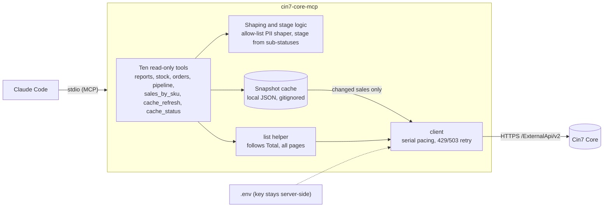

# cin7-core-mcp

A read-only [MCP](https://modelcontextprotocol.io) server that lets Claude Code answer business questions about a [Cin7 Core](https://www.cin7.com/) (formerly DEAR Inventory) account: overdue receivables, sales summaries, stock value and health, order status and the open-orders pipeline. Status: **ten tools, line-level cache, sandbox only**; see [Project status and how to resume](#project-status-and-how-to-resume).

## The problem

Cin7 Core's REST API is a record store, not a reporting API. Getting an answer out of it is harder than it looks:

- **No aggregate or reporting endpoints.** Totals, margins, valuation and "what is overdue" must be computed client-side.
- **List endpoints return headers only.** Line-level questions need one detail call per record, under a limit of **60 calls/min per key** (173 sales is about 3 minutes; larger accounts far more).
- **Definition traps** that give plausible but wrong numbers: the list rollups (`InvoiceAmount`, documented as net of credit notes) can disagree with the invoice and credit-note documents (about 30% of sandbox sales), `StockOnHand` is a *value* not a unit count, paging defaults to 100 rows, Advanced and Simple sales roll their statuses up differently, "today" depends on the tenant time zone.
- **Reporting limits are a recurring ERP complaint** (see [`docs/research/user-complaints.md`](docs/research/user-complaints.md)).

A capable Claude Code session can already call the API with Bash and the key, but it re-derives these rules each time, sometimes gets them wrong, and needs the API key in its environment.

## Proposed solution

Outcome-oriented tools, not an endpoint wrapper. Each tool answers a business question with a small aggregate, bakes in the correct definitions (stated in the tool description and in every result), paces and retries requests against the rate limit, and keeps the API key out of the model's context.



### Does it actually help? (three evaluation waves, 2026-11-05 to 2026-11-06)

A/B test: Claude Code + Bash + the key (baseline) vs the same with this MCP. Questions, alternative readings and a kill criterion were pre-registered; ground truth is computed independently of `src/`; same model and permissions in both arms.

| Wave | Questions | Result | What it shows |
|---|---|---|---|
| 1 | Q1 to Q5, 20 runs | MCP 10/10, baseline 8/10; baseline 1.8x cost, 2.5x time | agreement with Cin7 list-rollup definitions (see the correction below) |
| 2 | Q6 to Q10 plus regression, 30 runs | MCP 15/15, baseline 12/15; baseline 1.4x cost, 2.1x time | the Q6 gap is a definition ambiguity; the master-status trap did not separate the arms |
| 3 | Q11 revenue by SKU on documents, 4 runs | MCP correct cold (169 s, first load) and warm (7 s); baseline wrong twice (299 s, 380 s) | the question that needs the whole sale-detail fan-out; first document-basis truth |

**Correction (merged in #15):** in waves 1 and 2, "correct" meant agreement with Cin7's list rollups (`InvoiceAmount` and friends), which differ from the invoice and credit-note documents on about 30% of sandbox sales. On documents neither arm matched Q1 (43 overdue sales versus 29), and on Q2 and Q3 the baseline was closer than the older tools. Those two tools (`receivables_overdue`, `sales_summary`) still read the list rollups and say so; moving them to the cache's document basis is the next planned step. Caveats: small samples, the same author wrote tools, questions and truth, the sandbox is small and synthetic, and a narrow MCP cannot answer questions outside its tools (the MCP arm declined an out-of-scope question; the baseline queried the API). Full numbers: [`docs/research/mvp-evaluation.md`](docs/research/mvp-evaluation.md); decisions: [ADR 0003](docs/adr/0003-read-only-reports-mvp.md), [ADR 0004](docs/adr/0004-pii-safe-shaping-and-stage-derivation.md), [ADR 0005](docs/adr/0005-line-level-snapshot-cache.md).

## Tools (read-only against Cin7; `cache_refresh` writes only the local cache file)

| Tool | Inputs | Answers |
|---|---|---|
| `cin7_connection_check` | none | Credentials work; company, currency, time zone |
| `receivables_overdue` | `asOf?` (yyyy-MM-dd, default today in tenant zone), `topN?` | Outstanding and overdue invoice balances, age buckets (1-30, 31-60, 61-90, 90+), largest overdue balances |
| `sales_summary` | `groupBy` (`month` / `channel` / `customer`), `from?`, `to?`, `topN?` | Invoiced revenue and sale counts from Cin7's list rollup (`InvoiceAmount`), voided sales excluded; omit dates for all time |
| `stock_position` | `location?`, `topN?` | Stock value and units by location, top products by value, count of negative-available stock |
| `order_lookup` | `orderNumber` | One sale by exact order number: stage (from sub-statuses), capped lines, fulfilment, invoices. **Personal contact data is dropped** (allow-list shaping) |
| `open_orders_pipeline` | `includePurchases?` | Open sales by workflow stage, stuck counts (awaiting pick / ship / invoice / payment), purchase orders awaiting receipt, and how many sales the master status misdescribes |
| `stock_health` | `topN?`, `includeReorder?` | Negative available stock, on-order-with-nothing-on-hand, products at or below their reorder point, availability formula mismatches (reads the product list: about 2 large calls) |
| `sales_by_sku` | `from?`, `to?`, `topN?`, `sortBy?`, `refresh?`, `maxMinutes?` | Revenue (ex-tax), quantity, cost and margin by SKU from the **line-level cache**, attributed by invoice or credit-note date. May warm the cache (about 1.1 s per invoiced sale); states coverage and returns `complete: false` while the window is not fully loaded |
| `cache_refresh` | `windowDays?` (or `all`), `full?`, `maxMinutes?` | Loads or refreshes the local snapshot: lists headers, fetches details only for changed sales, resumable at a time budget, progress notifications |
| `cache_status` | none | Local cache only (no Cin7 calls): size, last sync, window, pending details and a rollup-drift summary (Cin7 list totals vs invoice and credit-note documents) |

Not built yet (prioritised in [`docs/research/prioritisation.md`](docs/research/prioritisation.md)): explanations for negative stock, sales velocity and reorder suggestions, and any write operations.

## Tech

- **TypeScript** on Node 22+, ESM; official **MCP SDK v2** (`@modelcontextprotocol/server`), **Zod v4** schemas for tool input and output ([ADR 0002](docs/adr/0002-typescript-mcp-sdk-v2.md)).
- **stdio** transport (local Claude Code); native `fetch` for Cin7; no database, but a local JSON snapshot cache for line-level data ([ADR 0005](docs/adr/0005-line-level-snapshot-cache.md)). Streamable HTTP is deferred (ADR 0002).
- Decisions are recorded as ADRs: [0001](docs/adr/0001-record-architecture-decisions.md) process, [0002](docs/adr/0002-typescript-mcp-sdk-v2.md) stack, [0003](docs/adr/0003-read-only-reports-mvp.md) reports MVP, [0004](docs/adr/0004-pii-safe-shaping-and-stage-derivation.md) PII shaping and stage derivation, [0005](docs/adr/0005-line-level-snapshot-cache.md) line-level cache.
- Tooling: vitest (unit tests with synthetic fixtures), Biome (lint and format), `tsc`, npm.
- Implementation of individual tools is delegated to Haiku agents and reviewed (see `CLAUDE.md`).

## Setup

```bash
npm install
cp .env.example .env    # CIN7_ACCOUNT_ID, CIN7_APPLICATION_KEY, CIN7_BASE_URL (API root, no /v2)
npm run build
npm test                # typecheck, lint: npm run typecheck && npm run lint
```

The server loads the repo-root `.env` itself (path resolved from the script, so the launch directory does not matter) and appends `/v2` to `CIN7_BASE_URL`. Optional: `CIN7_CACHE_DIR` for the line-level cache location.

### Use with Claude Code
`.mcp.json` registers the server for this repo. Project-scoped servers need a one-time approval: run `claude` in the repo and accept it (check with `claude mcp list`). For other clients:

```json
{
  "mcpServers": {
    "cin7-core": { "command": "node", "args": ["/absolute/path/to/mcp7/dist/index.js"] }
  }
}
```
Debug with `npm run inspect`. Re-run the evaluation after changing tools: see [`eval/README.md`](eval/README.md). Runs are headless Claude sessions that cost real API money (a few cents each, dozens per wave) and the revenue-by-SKU truth script makes about 165 paced Cin7 calls: state the estimate and get approval first.

## Limitations

- **Sandbox only.** Built and tested against a Cin7 sandbox, which is small and synthetic. Production scale is untested.
- **Personal data:** `order_lookup` uses allow-list shaping (no contact person, email, phone, addresses or free-text notes) and caps lines. Other tools return aggregates but can include customer business names. There is no global response-size budget yet.
- **Line-level cache (ADR 0005).** `sales_by_sku` reads a local snapshot under `.cache/cin7` (override with `CIN7_CACHE_DIR`; gitignored). It holds business names, order lines and money, no contact data. First load is about 1.1 s per invoiced sale (about 160 s for the sandbox's 147), then refreshes are incremental. Revenue is a **document basis** (authorised invoices minus credit notes, ex-tax, by document date), unlike the older tools' list rollups. Results are labelled partial until the window is fully loaded.
- **Read-only.** Nothing writes to Cin7.
- **Rate limit.** Requests are serialised at about 1 per 1.1 s; the key is shared with anyone else using it.

## Project status and how to resume

All pull requests through #16 are merged; `master` is green (typecheck, lint, 194 tests, build). Ten tools, the snapshot cache, the evaluation harness (`eval/`, 11 pre-registered questions) and five ADRs exist. ADRs 0003, 0004 and 0005 are accepted provisionally, each with a "Progress and where to continue" section listing its gaps.

**Next, in order:** (1) move `receivables_overdue` and `sales_summary` onto the cache's document basis and re-evaluate against a document-based truth; (2) sales velocity and reorder suggestions on the cache; (3) explanations for negative stock; later, workflow writes (needs explicit consent and a confirmation design). Open items, user actions and unverified claims are tracked in the handoff document: [`docs/handoff/2026-11-06-cin7-mcp-roadmap.md`](docs/handoff/2026-11-06-cin7-mcp-roadmap.md) (index: [`docs/handoff/README.md`](docs/handoff/README.md)).

**Rules of engagement** (details in `CLAUDE.md` and [`docs/workflow-guide.md`](docs/workflow-guide.md)):
- Feature branch per change, one PR straight into `master`, no stacked PRs, commit and push; the maintainer reviews and merges.
- Implementation work is delegated to Haiku subagents (at most five at once); the main model writes shared, privacy-critical code and reviews every diff.
- The sandbox brief allows creating test data, but in practice writes are done only after asking (one throwaway sale was created and voided for the spike with explicit approval). Evaluation runs cost money and need approval.
- No customer or supplier names, order numbers, SKU codes, GUIDs or credentials in the repo; raw API data and run transcripts stay in gitignored `eval/out/` or the scratch area.
- Maintainer tooling outside the repo: the user-level `retire-chat` skill produces the handoff documents in `docs/handoff/` (it is not versioned here; see that folder's README).

## Repository layout

```
src/            index (stdio entry), server (factory), config, dates, stage, shape
  cin7/         HTTP client (pacing, retry), pagination helper, verified row types
  cache/        snapshot cache: schema, extractor, store, sync, query, progress
  tools/        one file per MCP tool
test/           vitest, synthetic fixtures
eval/           pre-registered A/B evaluation: questions, truth scripts, runner (output in eval/out, ignored)
http/           read-only JetBrains HTTP Client requests for manual inspection
docs/           research, ADRs, design sketches, glossary, workflow guide, handoff documents
```

## Docs

[`docs/README.md`](docs/README.md) indexes the research (Cin7 API reference, MCP landscape, user complaints, sandbox findings, prioritisation, evaluation, line-cache spike), design sketches (mermaid), ADRs and glossary. [`docs/workflow-guide.md`](docs/workflow-guide.md) explains how we work with Claude Code. [`CLAUDE.md`](CLAUDE.md) holds working conventions. [`docs/handoff/`](docs/handoff/README.md) holds the dated handoff documents.

Licensed under Apache-2.0.
