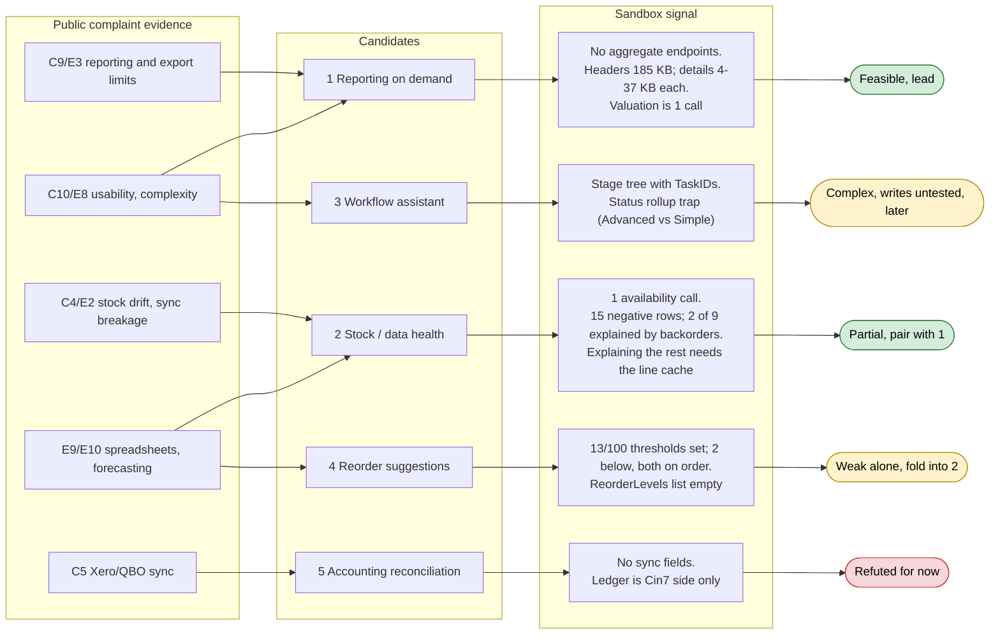

# Candidate map: complaint evidence → data signal → verdict

Source: [../research/sandbox-findings.md](../research/sandbox-findings.md) and [../research/user-complaints.md](../research/user-complaints.md). Sandbox signals show feasibility and cost, not how common the pain is.

