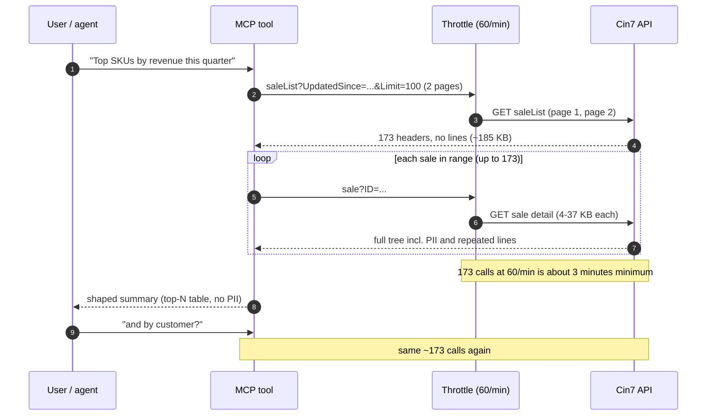
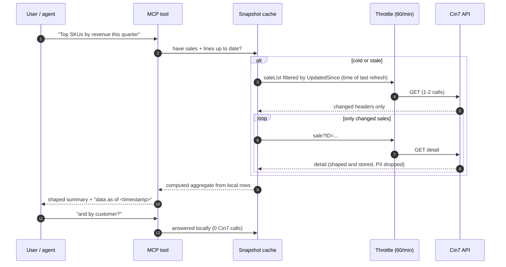

# Fan-out sequence: line-level report under the 60 calls/min cap

Why a cache matters for the lead candidate (reporting + stock health). Numbers are from the sandbox (173 sales); production may be larger.

## Without a cache: every question repeats the fan-out

## With a snapshot cache: pay once, refresh incrementally

Open design questions: cache location (memory vs local file/SQLite), freshness policy (TTL vs `UpdatedSince` only vs webhooks, which need the Automation add-on), and a "refresh in progress" response for the first load (MCP tasks or progress notifications).
