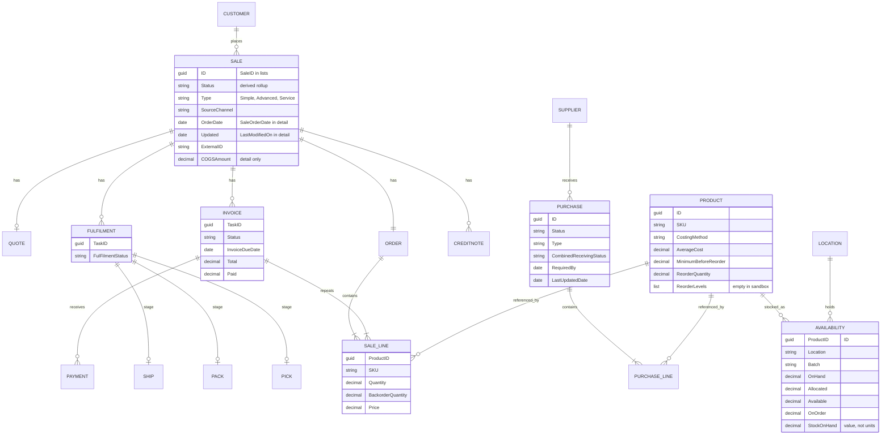

# Observed entities (from sandbox payload shapes)

Field names only, from list and detail responses seen 2026-11-05. Not exhaustive. Cin7 identifies things by GUID but takes many foreign keys **by name** on writes (location, tax rule, terms, price tier, carrier, unit, category, brand).

Personal data sits at the top level of the sale detail (`Customer`, `Contact`, `Phone`, `Email`, billing and shipping addresses) and in invoice billing lines. Shaped outputs drop it by default.
