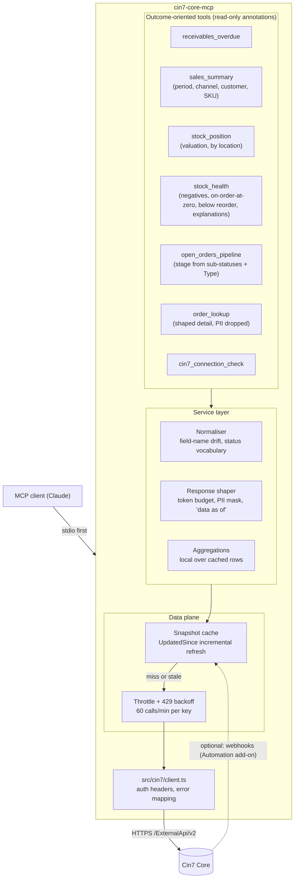

# Tool architecture sketch (draft, pending the problem-selection ADR)

For the leading direction: a **read-only operations insight server** (candidates 1 + 2). Tool names are placeholders. The workflow assistant (candidate 3) would add a separate, confirmation-gated write module later.

## Principles carried from the research

- Outcome-oriented tools, few of them, each with a bounded response size ([mcp-landscape.md](../research/mcp-landscape.md) §3).
- Read-only by default; the Cin7 API key is unscoped, so safety is our responsibility, not the key's.
- Every answer states freshness ("data as of ...") because the cache is a snapshot.
- First-load can take minutes at 60/min: surface progress rather than blocking silently.
- PII never leaves the service layer unless a tool explicitly asks for it.
