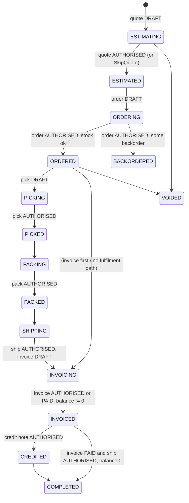
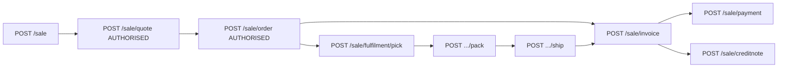
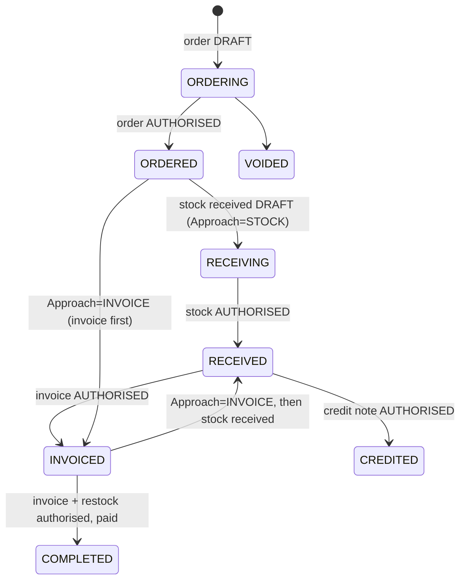

# Cin7 Core (formerly DEAR Inventory) API - Developer Reference

Fetched 2026-11-05. Primary source: the API Blueprint behind https://dearinventory.docs.apiary.io, downloaded from `https://jsapi.apiary.io/apis/dearinventory.apib` (31.5k lines, HTTP 200). Everything below is from that blueprint unless tagged **[secondary]** or **[UNVERIFIED]**. Field lists are summarised, not exhaustive: the blueprint has full tables per endpoint.

Conventions: "list" = `*List` summary endpoint; "detail" = single-record endpoint. Path casing in the docs is inconsistent (`/ExternalApi/v2`, `/externalapi/v2`); treat paths as case-insensitive **[UNVERIFIED]**.

---

## 1. Overview

| Topic | Detail |
|---|---|
| Base URL | `https://inventory.dearsystems.com/ExternalApi/v2/` (blueprint `HOST`; prose says `/externalapi/v2/`) |
| Auth | Two HTTP headers on every request: `api-auth-accountid`, `api-auth-applicationkey`. Created on the "API setup" page inside the app (`https://inventory.dearsystems.com/ExternalAPI`). Each company has its own Account ID; multiple API Applications (keys) per account. |
| Rate limit | `429 Too Many Requests` = "You reached 60 calls per minute API limit". Docs say limits are applied **per API Application** (per key). No documented `Retry-After` / rate-limit response headers **[UNVERIFIED whether sent]**. |
| Content type | JSON only ("The API accepts only JSON data format"). Requests use `Content-type: application/json`. |
| Dates | ISO 8601, UTC, `yyyy-MM-ddTHH:mm:ss.fff` (e.g. `2012-11-14T13:28:33.363`). Applies to fields and query params. Some fields are date-only (`Date` type, e.g. `ShipBy`, `SaleOrderDate`); product custom date attributes use `yyyy-mm-dd`. |
| Pagination | `Page` (default 1) and `Limit` (default 100, min 1, **max 1000**). Response carries `Total` (overall record count) and `Page` plus a named array. Docs list pagination as supported on: SaleList, PurchaseList, StockAdjustmentList, StockTakeList, StockTransferList, Product, Category, and say all other endpoints do not paginate. **But** many other endpoints document `Page`/`Limit` params (Customer, Supplier, locations, tax, units, availability, transactions, production lists, CRM...). Treat as inconsistent docs; always send Page/Limit and read `Total`. Behaviour when Limit > 1000 **[UNVERIFIED]**. |
| Response shape | List: `{ "Total": n, "Page": p, "<XxxList>": [ ... ] }`. Array key varies per resource (see table below). Detail: object directly (or `{Total,Page,Products:[...]}` for `/product?ID=`). |
| Errors | HTTP status + body matching Error Model: `{ "ErrorCode": int, "Exception": "text" }`. Must read both status and message. |
| Status codes | 200 OK; 204 No Content; 400 bad request or validation failure; 403 auth failed; 404 endpoint not found (e.g. `/Products`); 405 method not allowed; 429 rate limit; 500 unparseable object or unexpected server error. |
| Versioning | Single `v2` in the URL. v1 documented only on the old support site (`http://support.dearsystems.com/solution/folders/1000134185`). Some endpoints marked deprecated (`/purchase`, see 2.2). `Product Markup Prices` block is marked "planned API, not available yet". |
| Sandbox | No sandbox documented. Docs state trial accounts can use the API, so a trial account is the de facto test environment. |
| Queueing advice | Docs tell integrators to queue requests and retry on network failure. |
| Write semantics | "POST will overwrite data in the related document (lines, additional charges etc.) and add new supplied entries" (stated for Sale and Purchase groups). PUT needs the record `ID`/`TaskID`. `DELETE ...&Void=true` voids; `Void=false` "undoes" (see 3). |

List response array keys (verified from example payloads): `Products`, `ProductAvailabilityList`, `CategoryList`, `BrandList`, `CustomerList`, `SupplierList`, `LocationList`, `TaxRuleList`, `PaymentTermList`, `CarrierList`, `UnitList`, `AccountsList`, `PriceTiers`, `SaleList`, `PurchaseList`, `StockAdjustmentList`, `StockTransferList`, `Webhooks`, `ProductFamilies`, `ProductSuppliers`, `ProductionOrderListItems`, `Resources`, `Workcenters`, `SuspendReasons`, `Deals`, `DiscountRules`, `ShipZones`, `MeAddressesList`, `MeContactsList`, `Transactions`, `LeadList`, `opportunityList` (lowercase o), `Tasks`, `Workflows`. Keys for `StockTakeList`, `SaleCreditNoteList`, `PurchaseCreditNoteList`, `MoneyTaskList`, `disassemblyList`, `finishedGoodsList`, `inventoryWriteOffList` not confirmed here **[UNVERIFIED]**.

Identity: all IDs are GUIDs. Names (location, tax rule, terms, price tier, carrier, UOM, category, brand, account code) are passed **as strings by name**, not IDs, in most POST/PUT bodies; they must already exist in reference data.

---

## 2. Resource map

### 2.1 Products / Inventory / Availability

| Endpoint | Verbs | Key params / notes |
|---|---|---|
| `/product` | GET, POST, PUT | GET: `ID`, `Page`, `Limit`, `Name`, `Sku`, `ModifiedSince`, `IncludeDeprecated` (default false = active only), opt-in expansions `IncludeBOM`, `IncludeSuppliers`, `IncludeMovements`, `IncludeAttachments`, `IncludeReorderLevels`, `IncludeCustomPrices` (all default false). Description says Name/Sku "containing", example list says "starting with" (conflict). |
| `/product/attachments` | GET (`ProductID`), POST, DELETE (`ID`) | |
| `/ref/productavailability` | GET | `Page`,`Limit`,`ID`,`Name`,`Sku`,`Location`,`Batch`,`Category`. One row per product x location x bin x batch. Fields: `ID` (product), `SKU`, `Name`, `Barcode`, `Location`, `Bin`, `Batch`, `ExpiryDate`, `OnHand`, `Allocated`, `Available`, `OnOrder`, `StockOnHand`, `InTransit`, `NextDeliveryDate`. |
| `/ref/category` | GET, POST, PUT, DELETE | paginated; `Name` filter |
| `/ref/brand`, `/ref/unit` | GET, POST, PUT, DELETE | `Name` filter |
| `/productFamily` | GET, POST, PUT (+ `/productFamily/attachments`) | GET: `ID`,`Name`,`Sku`,`ModifiedSince`. Variants/families. |
| `/product-suppliers` | GET (`ProductID`), POST, PUT, DELETE (`ProductID`,`SupplierID`) | supplier cost/lead-time options per product |
| `/custom-prices` | POST, PUT, DELETE (`ProductID`,`CustomerID`) | customer-specific prices; read via `/product?IncludeCustomPrices` or `/customer?IncludeProductPrices` |
| `/reference/deals`, `/reference/discount` | GET, POST, PUT | pricing deals/discount rules; `Search`,`ID`,`Page`,`Limit` |
| `/product/markupprices` | GET, PUT | **Marked "planned API, not available yet"**. |
| `/transactions` | GET | `FromDate`,`ToDate`,`Account`,`Page`,`Limit`. Ledger-style transactions. Closest thing to a financial report. |

Product key fields: `ID`, `SKU` (unique, required), `Name`, `Category`, `Brand`, `Type` (`Stock`/`Service`, read-only on PUT), `CostingMethod` (`FIFO`, `Special - Batch`, `Special - Serial Number`, `FIFO - Serial Number`, `FIFO - Batch`, `FEFO - Batch`, `FEFO - Serial Number`), `DropShipMode`, `UOM`, `DefaultLocation`, `Barcode`, `PriceTier1..10` (or `PriceTiers` object), `AverageCost` (read-only), `MinimumBeforeReorder`, `ReorderQuantity`, `Status` (`Active`, `Setup required`, `Deprecated`), `Sellable`, `Tags` (comma string), `AdditionalAttribute1..10`, `AttributeSet`, account fields (`COGSAccount`, `RevenueAccount`, `ExpenseAccount`, `InventoryAccount`), `PurchaseTaxRule`, `SaleTaxRule`, `BillOfMaterial`, `AutoAssembly`, `AutoDisassembly`, `QuantityToProduce`, `AssemblyCostEstimationMethod`, `BOMType` (read-only), `HSCode`, `CountryOfOrigin(Code)`, `LastModifiedOn` (read-only), plus nested `Suppliers`, `ReorderLevels`, `BillOfMaterialsProducts`, `BillOfMaterialsServices`, `Movements`, `Attachments`, `CustomPrices`.
Product Movement `Type` values include Purchase, Advanced Purchase, Unstock, Sale, SaleMultiple, Restock, Adjustment, Stocktake, Transfer In/Out, Finished Goods, Inventory Write-Off, Disassembly and their "Cost Change"/"COGS Change" variants (docs spell one "Purchase Cost Chang").

Quirks: `Weight` is "in kilograms" while `WeightUnits` field also exists (conflict in docs). `Type` required on POST only. Deprecated products hidden unless `IncludeDeprecated=true`.

### 2.2 Sales

Sale is a **master task** (`SaleID` = `ID`) with child tasks, each with its own `TaskID`. Types: **Simple Sale** (one invoice/fulfilment/credit note), **Advanced Sale** (multiple), **Service Sale** (`ServiceOnly=true` at creation, cannot be changed; no Order/Fulfilment endpoints; `TaskID = SaleID`).

| Endpoint | Verbs | Notes |
|---|---|---|
| `/saleList` | GET | Params: `Page`,`Limit`,`Search` (OrderNumber, Status, Customer, InvoiceNumber, CustomerReference, CreditNoteNumber), `CreatedSince`,`UpdatedSince`,`UpdatedUntil`,`ShipBy` (on/before, only with non-authorised shipment), `QuoteStatus`,`OrderStatus`,`CombinedPickStatus`,`CombinedPackStatus`,`CombinedShippingStatus`,`CombinedInvoiceStatus`,`CreditNoteStatus`,`Status`,`ExternalID`,`ReadyForShipping` (pack authorised + ship not authorised),`OrderLocationID`. |
| `/saleCreditNoteList` | GET | same style filters, `CreditNoteStatus` |
| `/sale` | GET, POST, PUT, DELETE | GET `ID` + `CombineAdditionalCharges`,`HideInventoryMovements`,`IncludeTransactions`,`CountryFormat` (`Regular`/`Code2`/`Code`). Returns the full nested tree (Quote, Order, Fulfilments, Invoices, CreditNotes, ManualJournals, Attachments, InventoryMovements, Transactions). DELETE `ID`,`Void`. |
| `/sale/quote` | GET (`SaleID`,`CombineAdditionalCharges`,`IncludeProductInfo`), POST | POST status only `DRAFT`/`AUTHORISED`. Errors if quote not DRAFT/NOT AVAILABLE, or sale has `SkipQuote=true`. |
| `/sale/order` | GET, POST | Requires quote `AUTHORISED` (unless SkipQuote). POST accepts `AutoPickPackShipMode` (default `NOPICK`) - only for Simple Sale with no backorder when order becomes `AUTHORISED`. |
| `/sale/fulfilment` | GET, POST, DELETE (`TaskID`,`Void`) | POST creates a Fulfilment task; errors unless order `AUTHORISED`; only if no fulfilment has non-authorised pick. Adding one to a Simple Sale converts it to **Advanced Sale**. |
| `/sale/fulfilment/pick`, `/pack`, `/ship` | GET (`TaskID`), POST, PUT | Pick/pack status values `NOT AVAILABLE`,`DRAFT`,`AUTHORISED`,`VOIDED`; POST accepts `DRAFT`/`AUTHORISED`. POST adds lines; PUT replaces but needs non-authorised stage. Pack POST errors if pick not authorised; Ship POST errors if pack not `AUTHORISED` or shipment already (partially) authorised. Ship PUT payload must list **all packed boxes**. Shipping endpoint unusable for products in external fulfilment locations. Ship status becomes `AUTHORISED` automatically when all packed boxes shipped; ship statuses include `PARTIALLY AUTHORISED`. Pick/pack line: `ProductID`,`SKU`,`Location`/`LocationID`,`Quantity`,`BatchSN`,`ExpiryDate`,`Box`. Ship line: `ShipmentDate`,`Carrier`,`Boxes` (field is `Box` in POST/PUT),`TrackingNumber`,`TrackingURL`(ro),`IsShipped`. |
| `/sale/invoice` | GET, POST, PUT, DELETE (`TaskID`,`Void`) | Statuses `DRAFT`,`AUTHORISED`,`VOIDED`,`PAID`,`NOT AVAILABLE`; POST only `DRAFT`/`AUTHORISED`. Fields: `InvoiceDate`,`InvoiceDueDate`,`LinkedFulfillmentNumber`,`Lines`,`AdditionalCharges`. |
| `/sale/creditnote` | GET (+`IncludePaymentInfo`), POST, DELETE | POST needs invoice `AUTHORISED`/`PAID`, `CreditNoteInvoiceNumber`, optional `Restock` lines (`RestockLocation(ID)`,`RestockDate`). `TaskID` = empty GUID creates a new credit note task. Standalone credit notes not supported. |
| `/sale/payment` | GET (`SaleID`), POST, PUT, DELETE (`ID`) | `Type`: `PREPAYMENT`,`PAYMENT`,`REFUND`. Prepayment only when order/invoice not authorised and quote authorised; Payment only with authorised invoice; Refund only with authorised credit note. `Account` = bank account code; `CreditID` to pay from customer credit. |
| `/sale/manualJournal`, `/sale/attachment` | GET, POST (+DELETE attachment) | |
| `/ref/customer/credits` | GET | `CustomerID`,`ShowUsedCredits` |

Sale create body (POST `/sale`) key fields: `Customer` or `CustomerID`, `Location` (required), `SaleType` (`Simple`/`Advanced`, POST only), `ServiceOnly`, `SkipQuote`, `TaxRule`, `TaxInclusive`, `Terms`, `PriceTier`, `ShipBy`, `SaleOrderDate`, `Carrier`, `SalesRepresentative`, `CurrencyRate` (required if customer currency differs from base), `CustomerReference`, `ExternalID` (API-only custom field, searchable via saleList), addresses, `AdditionalAttributes`. Status `DRAFT` "is not used for sales created via POST API".
Line models: `ProductID`/`SKU`, `Name`, `Quantity` (docs: "minimal value is 1"), `Price`, `Discount` (0-100), `Tax`, `TaxRule`, `Total` (for validation), `AverageCost`, `Comment`, `DropShip`, `BackorderQuantity` (ro on POST). Totals `TotalBeforeTax`,`Tax`,`Total` not required on POST.

### 2.3 Purchases

Two parallel endpoint families:
- `/purchase/*`: **deprecated, Simple Purchases only** ("Please use Advanced Purchase").
- `/advanced-purchase/*`: supports Simple, Advanced, Service purchases. Service purchases are additional-charges only.

| Endpoint | Verbs | Notes |
|---|---|---|
| `/purchaseList` | GET | `Page`,`Limit`,`Search`,`RequiredBy`,`UpdatedSince`,`UpdatedUntil`,`OrderStatus`,`RestockReceivedStatus`,`InvoiceStatus`,`CreditNoteStatus`,`UnstockStatus`,`Status`,`DropShipTaskID`. Doc quirk: path template reads `Status{Status}` (missing `=`). |
| `/purchaseCreditNoteList` | GET | similar |
| `/advanced-purchase` | GET (`ID`,`CombineAdditionalCharges`), POST, PUT, DELETE (`ID`,`Void`) | Required on POST: `Approach` (`INVOICE` = invoice first, `STOCK` = stock first), `Location`, `Supplier`/`SupplierID`. `BlindReceipt=true` = no order stage. |
| `/advanced-purchase/stock` | GET (`PurchaseID`), POST, PUT, DELETE (`TaskID`,`Void`) | Stock received. Only when "Use Put Away" general setting is on. POST/PUT on a Simple Purchase converts it to Advanced. Not for Service purchases. |
| `/advanced-purchase/put-away` | GET, POST | |
| `/advanced-purchase/invoice` | GET, POST, DELETE | |
| `/advanced-purchase/creditnote` | GET, POST, DELETE | |
| `/advanced-purchase/payment` | GET (`PurchaseID`,`OrderNumber`,`InvoiceNumber`,`CreditNoteNumber`), POST, PUT, DELETE (`/purchase/payment?ID&DeleteAllocation`) | |
| `/advanced-purchase/manualJournal`, `/purchase/attachment` | GET, POST | |
| `/purchase/order`, `/purchase/stock`, `/purchase/invoice`, `/purchase/creditnote`, `/purchase/payment`, `/purchase/manualJournal` | GET (`TaskID`) / POST | deprecated simple-purchase family |

Purchase ordering rules (from POST notes): order POST needs order status DRAFT/NOT AVAILABLE; stock-received POST needs order `AUTHORISED` and stock status DRAFT/NOT AVAILABLE, and if `Approach=INVOICE` the invoice must be `AUTHORISED` first; invoice POST needs order `AUTHORISED`, and if `Approach=STOCK` stock received must be `AUTHORISED` first; stock POST "adds only new stock lines".
Purchase list `Type`: `Simple Purchase`, `Advanced Purchase`, `Service Purchase`; also `IsServiceOnly`, `DropShipTaskID`, `BlindReceipt`.

### 2.4 Customers / Suppliers / Contacts

| Endpoint | Verbs | Notes |
|---|---|---|
| `/customer` | GET, POST, PUT | GET: `Page`,`Limit`,`ID`,`Name` (starts-with), `ContactFilter` (contact name starts-with or email equals), `ModifiedSince`,`IncludeDeprecated`,`IncludeProductPrices`. Fields: `Name` (unique), `DisplayName`, `Status` (`Active`/`Deprecated`), `Currency`,`PaymentTerm`,`AccountReceivable`,`RevenueAccount`,`TaxRule` (all required), `PriceTier`,`Carrier`,`SalesRepresentative`,`Location`,`Discount`,`CreditLimit`,`IsOnCreditHold`,`TaxNumber`,`Tags`,`AttributeSet`,`AdditionalAttribute1..10`, hierarchy (`IsLegalEntity`,`CustomerParentID`,`IsBillParent`, read-only `ChildCustomers`), nested `Addresses`,`Contacts`,`ProductPrices`. No DELETE: deprecate via `Status`. |
| `/ref/customer/templates` | GET, POST, DELETE | default document templates per customer |
| `/supplier` | GET, POST, PUT | same shape as customer (`IncludeDeprecated`,`ModifiedSince`,`Name`) |
| `/ref/supplier/deposits` | GET | `SupplierID`,`ShowUsedDeposits` |
| `/me/contacts`, `/me/addresses` | GET, POST, PUT, DELETE | **Your own company's** contacts/addresses, not customers'. |
| `/crm/lead`, `/crm/opportunity`, `/crm/task`, `/crm/taskcategory`, `/crm/workflow`, `/crm/workflowstart` | GET/POST/PUT | CRM module. Doc quirk: the GET headers for taskcategory and workflow are written as `/crm/task?...`. |

### 2.5 Stock adjustments / transfers / takes / write-offs

| Endpoint | Verbs | Notes |
|---|---|---|
| `/stockadjustmentList` | GET | `Page`,`Limit`,`Status` |
| `/stockadjustment` | GET, POST, PUT, DELETE (`ID`,`Void`) | Status `DRAFT`,`COMPLETED`,`VOIDED` (POST/PUT: DRAFT/COMPLETED). `UpdateOnHand` boolean: **default false = adjusts Available, not OnHand**. Body has `Lines` (New Stock Line Model); response splits into `ExistingStockLines` (non-zero stock) and `NewStockLines` (zero stock). `Account` expense account. |
| `/stockTakeList`, `/stocktake` | GET, POST, PUT, DELETE | Statuses `DRAFT`,`IN PROGRESS`,`COMPLETED`,`VOIDED`. Filters `Tags`,`PickZones`,`StockLocators`,`Categories`,`Brands`,`Bins`. Lines auto-filled into `NonZeroStockOnHandProducts` on POST or on DRAFT->IN PROGRESS PUT; `ZeroStockOnHandProducts`; `UseRelativeQuantity`. |
| `/stockTransferList`, `/stockTransfer`, `/stockTransfer/order` | GET, POST, PUT, DELETE (`ID`,`Void`) | Statuses `DRAFT`,`IN TRANSIT`,`COMPLETED`,`VOIDED`. `From`/`FromLocation`, `To`/`ToLocation`, `InTransitAccount`+`DepartureDate` required for IN TRANSIT, `SkipOrder` default true, `CostDistributionType` (`Cost`,`Quantity`,`Weight`,`Volume`). Transfer order status `DRAFT`/`AUTHORISED`/`NOT AVAILABLE`. |
| `/inventoryWriteOffList`, `/inventoryWriteOff` | GET, POST, PUT, DELETE | |
| `/journal` | GET, POST, PUT, DELETE | manual journals (GET has `TaskID`,`Status`,`Search`) |
| `/moneyTaskList`, `/moneyOperation`, `/bankTransfer` | GET, POST, PUT, DELETE | money tasks / bank transfers |

### 2.6 Production / Assembly / BOM

Two generations coexist:
- **Simple assembly/disassembly** (kit-style): `/finishedGoodsList`, `/finishedGoods` (+`/finishedGoods/order`, `/finishedGoods/pick`), `/disassemblyList`, `/disassembly` (+`/disassembly/order`). Assembly BOM for a product is defined via `BillOfMaterial*` fields on `/product`. Finished Goods GET list has `Status`,`Search`,`SaleID`. DELETE `ID`,`Void`.
- **Production module** (`/production/*`): 
  - `/production/productionBOM` GET/POST/PUT/DELETE by `ProductID` or `ProductFamilyID` (+`BOMID`), `ReturnAttachmentsContent`.
  - `/production/order` GET (`ProductionOrderID`)/POST (`RecalculateDates`)/PUT (`AllowRecalculateDates`,`AllowRecalculateCyclesAndQuantities`); actions `POST /production/order/authorise` (recalculates capacity), `/release`, `/undo`, `/void`; attachments `/production/order/attachment` (GET/POST/PUT/DELETE); `GET /production/order/referenceData`.
  - `/production/orderList` GET: `Page`,`Limit`,`Status` (`AllButVoided`,`Draft`,`Planned`,`Released`,`InProgress`,`Completed`),`Search`,`LocationID`,`RequiredByDateFrom/To`,`CompletionDateFrom/To`,`SourceTaskID`. Array key `ProductionOrderListItems`.
  - `/production/order/run` GET/POST/PUT; `PUT .../run/complete`, `/undo`, `/void`, `/manualJournal`, `/operation/start`, `/suspend`, `/resume`, `/complete`.
  - Reference: `/production/resourceList`, `/production/resource`, `/production/workcenters`, `/production/suspendReason`, `/production/factoryCalendar?Year=`.

Production order statuses (from list filter): Draft, Planned, Released, InProgress, Completed (plus voided). Detailed transition rules **[not extracted; see blueprint lines ~8844-12300]**.

### 2.7 Reference data

| Endpoint | Verbs | Notes |
|---|---|---|
| `/me` | GET | Company, base `Currency`, `TimeZone`, default weight/dimension units, `LockDate` (no changes before this date), `OpeningBalanceDate`, `TaxCalculationMethod`, `DefaultSaleTaxRuleId/Name`, discount settings, `RoundingTable`. Good connectivity/identity probe. |
| `/ref/location` | GET, POST, PUT, DELETE | `ID`,`Name` (starts-with),`Deprecated` (**returns only deprecated** when true) |
| `/ref/tax` | GET, POST, PUT | `IsActive`,`IsTaxForSale`,`IsTaxForPurchase`,`Account`,`Name`; array `TaxRuleList` |
| `/ref/priceTier` | GET | returns `{Code, Name}` x10 |
| `/ref/paymentterm` | GET, POST, PUT, DELETE | `Method`,`IsActive`,... |
| `/ref/carrier` | GET, POST, PUT, DELETE | `CarrierID`,`Description` |
| `/ref/account`, `/ref/account/bank` | GET (+POST/PUT/DELETE for CoA) | Chart of accounts: `Code`,`Name`,`Type`,`Status`; array `AccountsList` |
| `/ref/templates` | GET | document templates, `Type`,`Name` |
| `/ref/attributeset` | GET, POST, PUT, DELETE | custom attribute sets |
| `/ref/fixedassettype` | GET, POST, PUT | |
| `/ref/unit`, `/ref/brand`, `/ref/category` | see 2.1 | |
| `/reference/shipZones`, `/reference/shipZonesEnabled` | GET/POST/PUT/DELETE | shipping zones |

### 2.8 Webhooks

Requires the **Automation module** on the subscription (contact support). `/webhooks` GET, POST, PUT, DELETE (`ID`).
- Fields: `ID`, `Type`, `Name` (read-only), `IsActive`, `ExternalURL`, `ExternalAuthorizationType` (`noauth`/`basicauth`/`bearerauth`), `ExternalUserName`/`ExternalPassword`/`ExternalBearerToken`, `ExternalHeaders[{Key,Value}]`.
- **Max 5 webhooks of the same type.**
- Retry: 6 attempts; first 1 min after event, then +5, +10, +15, +20, +25 min after the previous. If all fail the webhook is **deactivated**.
- Types: `Sale/Created`, `Sale/QuoteAuthorised`, `Sale/OrderAuthorised`, `Sale/Voided`, `Sale/Backordered`, `Sale/ShipmentAuthorised`, `Sale/InvoiceAuthorised`, `Sale/PickAuthorised`, `Sale/PackAuthorised`, `Sale/CreditNoteAuthorised`, `Sale/Undo`, `Sale/PartialPaymentReceived`, `Sale/FullPaymentReceived`, `Sale/AttachmentAdded`, `Sale/AdditionalAttributesChanged`, `Sale/ShipmentTrackingNumberChanged`, `Purchase/OrderAuthorised`, `Purchase/InvoiceAuthorised`, `Purchase/StockReceivedAuthorised`, `Purchase/CreditNoteAuthorised`, `Purchase/Updated`, `Customer/Updated`, `Supplier/Updated`, `Product/Updated`, `Stock/AvailableStockLevelChanged`, `Lead/Updated`, `Lead/Converted`, `Opportunity/Authorized|AttachmentAdded|Voided|Converted`, `Task/Overdue`.
- Payloads are thin notifications (e.g. `Sale/Created`: `SaleID`, `SaleOrderNumber`, `CustomerName`, contact name/email, `SaleRepEmail`, `SaleOrderDate`, `TaskTypeSign`, `IsServiceOnly`, `DownloadLink`, `EventType`). Fetch the record afterwards. No signature/HMAC scheme documented **[UNVERIFIED]**; auth is the basic/bearer/custom header you configure.

---

## 3. Lifecycle / state notes

Sale master `Status` is a derived roll-up of sub-statuses (values: DRAFT, VOIDED, ESTIMATING, ESTIMATED, ORDERING, ORDERED, BACKORDERED, PICKING, PICKED, PACKING, PACKED, SHIPPING, INVOICING, INVOICED, CREDITED, COMPLETED). PICKING..SHIPPING and INVOICING/INVOICED/CREDITED are documented as "only applicable to simple sale".

The INVOICING-from-ORDERED edge is inferred from the status definition (`OrderStatus=AUTHORISED, InvoiceStatus=DRAFT`); exact reachable paths are **[UNVERIFIED]**. Sub-status vocabularies: Quote/Order/Invoice `NOT AVAILABLE`,`DRAFT`,`AUTHORISED`,`VOIDED` (Order adds `AUTH_NO_ALLOC`,`FULFILLED`,`CLOSED`; Invoice adds `PAID`); `CombinedPickingStatus` (`NOT PICKED`,`PARTIALLY PICKED`,`PICKING`,`PICKED`...), `CombinedPackingStatus`, `CombinedShippingStatus`, `FulFilmentStatus`, `CombinedPaymentStatus` (`UNPAID`,`PARTIALLY PAID`,`PAID`,`PREPAID`,`NOT REFUNDED`,`VOIDED`).

Sale API write order (each step is a separate call; each errors if the prior stage is not authorised):

Purchase `Status` values: DRAFT, VOIDED, ORDERING, ORDERED, RECEIVING, RECEIVED, INVOICED, CREDITED, `RECEIVING / CREDITED`, `RECEIVED / CREDITED`, PARTIALLY INVOICED, COMPLETED. `Approach` picks which of invoice/stock comes first.

(Purchase diagram simplified; combined states like PARTIALLY INVOICED not drawn.)

Void vs undo: every `DELETE ...?ID=...&Void={bool}` is documented as "Void or Undo". `Void=true` voids; `Void=false` (default) undoes/reverts the stage **[exact semantics UNVERIFIED]**. Sale/Purchase child stages use `TaskID` + `Void`.

---

## 4. Gotchas

**List vs detail**
- `saleList`/`purchaseList` return header-level data only: no lines, no addresses, no fulfilment/invoice task IDs, no payments detail (only `PaidAmount`/`InvoiceAmount` roll-ups, combined statuses, `ExternalID`, `OrderLocationID`). To get lines you need `GET /sale?ID=` (full tree) or the stage endpoints `/sale/order`, `/sale/invoice` etc. by `SaleID`/`TaskID`.
- `saleList.InvoiceAmount` = invoices minus credit notes; `SaleInvoicesTotalAmount` = invoices only. `PaidAmount` = paid minus refunded.
- `stockTakeList`/`stockadjustmentList`/`stockTransferList` give headers; lines require the detail call by `TaskID`.
- `/product` list returns full product records but nested `Suppliers`, `BOM`, `Movements`, `Attachments`, `ReorderLevels`, `CustomPrices` are opt-in via `Include*` flags (default off).
- `/customer` list omits customer-specific prices unless `IncludeProductPrices=true`.
- Availability is a separate endpoint (`/ref/productavailability`); product records contain no stock quantities.

**Fan-out cost (60 calls/min/key)**
- "Sale with lines for the last N days" = 1 list call per 1000 sales + 1 detail call per sale. 500 sales ~ 500 calls ~ 8+ minutes at the cap.
- Stock position per SKU: availability endpoint is one row per product/location/bin/batch, so a full dump can be many pages.
- Task IDs for sub-stages (`/sale/fulfilment/pick?TaskID=`) require first reading the sale detail.

**Missing aggregates / reporting**: no endpoints for sales totals, margin/COGS reports, ageing, stock valuation, reorder report, top-N, or counts other than `Total` on paginated lists. `COGSAmount` exists on sale detail. `/transactions` (ledger lines by date/account) is the only financial-ish feed. Reports must be computed client-side from list+detail calls **[absence is inferred from the endpoint inventory]**.

**Idempotency / concurrency**: no idempotency keys, ETags, or optimistic-concurrency tokens are documented **[UNVERIFIED, absence not proven]**. Retrying a POST that creates a task could duplicate (except where a `TaskID` or `ID` is supplied). `ExternalID` on sales can be used as your own dedupe key via `saleList?ExternalID=`. Sales/purchases are state-machine gated; a stale call returns a 400 with an `Exception` message, which is effectively the concurrency control. `LockDate` (from `/me`) blocks changes to transactions before it.

**POST semantics**: POST "overwrites lines/charges and adds new entries"; PUT requires non-authorised stage for pack/ship replace. Mixed use of POST (add) and PUT (replace) per stage.

**Unusual names / doc inconsistencies**
- `Sale.ID` vs list `SaleID` vs child `TaskID`; purchase uses `PurchaseID` (master) and `TaskID` (children); stock docs use `TaskID` for the document id. Service Sale: `TaskID = SaleID`.
- `Sale.TaxCalculation` (`Inclusive`/`Exclusive`) on GET but `TaxInclusive` (bool) on POST/PUT.
- Ship line `Boxes` on GET vs `Box` on POST/PUT. `RequireBy` (ship) vs `RequiredBy` (purchase).
- List-array key casing differs (`opportunityList`, `ProductAvailabilityList`, `AccountsList`...).
- Typos in docs: `Customer` typed as Date in saleList; purchaseList `InvoiceStatus`/`UnstockStatus` descriptions swapped; `PurchaseList` path `Status{Status}`; "Purchase Cost Chang".
- Docs say line `Quantity` minimum is 1 although fields are "up to 4 decimal places" **[UNVERIFIED which wins]**.
- `Weight` "in kilograms" vs `WeightUnits` field.
- Foreign keys by name: `Location`, `TaxRule`, `Terms`, `PriceTier`, `Carrier`, `UOM`, `Category`, `Brand` must exactly match reference-data names; `Customer`/`Supplier` can be name or ID.
- Stock adjustment default adjusts **Available**, not On Hand, unless `UpdateOnHand=true`.
- Sale `DRAFT` status never appears for API-created sales.
- Webhook requires paid Automation module; deactivated silently after 6 failed deliveries.

---

## 5. MCP-relevant observations (no decisions)

1. **Multi-step write chains.** Creating a fully processed sale is 5-8 calls (sale, quote, order, pick, pack, ship, invoice, payment) with strict stage gating and different ID types (`SaleID` vs `TaskID`). An LLM issuing raw calls must discover TaskIDs from detail reads. Candidate: one "advance sale to stage X" workflow tool.
2. **Name-based foreign keys.** Locations, tax rules, terms, price tiers etc. are matched by exact string. Agents need reference-data lookup/validation (and likely cached `/me`, locations, tax, terms, tiers) to avoid 400s.
3. **Header-only lists.** Typical questions ("what's in order SO-123", "which open orders contain SKU X") need list + detail fan-out under a 60/min cap. Candidate: composed read tools with caching, concurrency limiting, and summary output.
4. **No search by line content or SKU on sales/purchases.** `Search` only covers header fields (order number, customer, invoice no., status, reference). SKU-in-order queries require scanning details.
5. **No aggregates.** Revenue, margin, stock valuation, overdue invoices, reorder lists would be client-side computation over many calls; token-heavy for an LLM if returned raw.
6. **Status vocabulary sprawl.** Sale has ~16 master statuses plus 8 combined sub-status fields with different value sets (some with spaces and slashes, e.g. `RECEIVING / CREDITED`). Filter params map to different fields (`CombinedPickStatus` param vs `CombinedPickingStatus` field). A normalised status layer would help.
7. **Simple vs Advanced vs Service variants** change which endpoints work and silently convert types (adding fulfilment or stock receipt converts Simple to Advanced). Deprecated `/purchase` vs `/advanced-purchase` is a trap; only the latter is current.
8. **Void/Undo overload** on DELETE with a boolean; destructive-ness is non-obvious. Write tools would need confirmation guards.
9. **Large payloads**: full sale/purchase/production detail with nested arrays, inventory movements and transactions; `Include*`/`Hide*` flags exist to trim but defaults are inconsistent (movements shown by default on `/sale`, hidden by default on `/product`).
10. **Pagination inconsistency**: docs say only a few endpoints paginate; others accept Page/Limit anyway. Consistent auto-pagination in the tool layer is needed, plus honouring `Total`.
11. **Rate-limit sharing**: limit is per API key; MCP concurrency (multiple agents/tools) can exhaust 60/min quickly; needs a client-side throttle and 429 backoff.
12. **Webhooks as thin pings** could feed cache invalidation, but need the Automation add-on and a reachable public URL (awkward for a local MCP server).
13. **Timestamps**: UTC ISO strings; `/me` gives tenant `TimeZone`; some `Date` fields are tenant-formatted (`LockDate`). Relative-date reasoning ("last week") needs the tenant timezone.
14. **Payments/credits** have special rules (prepayment vs payment vs refund by stage; `CreditID`), a likely source of agent errors.

---

## 6. Sources and verification status

Fetch date for all: **2026-11-05**.

| # | Source | Use | Status |
|---|---|---|---|
| 1 | https://jsapi.apiary.io/apis/dearinventory.apib (raw API Blueprint, HTTP 200, 1.75 MB) | Primary, all endpoint/field/status/rate-limit facts | Read directly (selected sections; large JSON examples skimmed) |
| 2 | https://jsapi.apiary.io/apis/dearinventory/api-description-document (HTTP 200, 2.2 MB, parsed AST form) | Downloaded, not separately analysed | Unused beyond confirming availability |
| 3 | https://dearinventory.docs.apiary.io (rendered docs) | Reference origin of the blueprint | Not fetched separately |

**Secondary sources (Cin7 Core help centre, GitHub clients, community posts) were NOT consulted** in this pass. Therefore nothing here is cross-checked, and real-world behaviours are untested.

Unverified / uncertain items (also marked inline):
- Behaviour when `Limit` > 1000; whether 429 responses carry `Retry-After`; real-world burst handling.
- Any idempotency/ETag/concurrency mechanism (none found in docs; absence not proven).
- Exact semantics of `Void=false` ("Undo") per resource, and the full Sale status reachability graph (diagram partly inferred).
- Path case-sensitivity; response keys for several list endpoints (listed in section 1).
- Webhook signature/verification (none documented); webhook payload shapes for all types (only a sample was read).
- Whether the minimum line `Quantity` of 1 actually blocks fractional quantities.
- Production module transition rules and field details (only endpoint inventory extracted).
- Whether the "planned" markup-prices API is now live; whether any sandbox exists.
- Docs themselves contain typos/inconsistencies (section 4), so field semantics should be confirmed against a trial account before building on them.

---

## 7. Verified against the sandbox (2026-11-05)

Read-only probes, 23 calls (22 for the investigation plus 1 spike), no 429s, latency 0.35-1.9 s at about 1 call per 1.2 s. These supersede earlier **[UNVERIFIED]** or doc-derived statements where they conflict. Counts are from a synthetic sandbox; see [sandbox-findings.md](sandbox-findings.md).

| Topic | Verified behaviour |
|---|---|
| Auth / base URL | Headers work as documented; base `https://inventory.dearsystems.com/ExternalApi/v2/`. `/me` returns `Company, Currency, TimeZone, LockDate, OpeningBalanceDate, TaxCalculationMethod, DefaultSaleTaxRuleId/Name, DiscountRule, RoundingTable, ...` |
| Pagination | `Limit=500` honoured on `/ref/productavailability` (483 rows in one call); `Limit=100` on `saleList`/`purchaseList`/`product`. `Total` present on all paginated lists. Product `Total` (1,559) is active-only by default. |
| Sale list fields | Date is **`OrderDate`** (detail uses `SaleOrderDate`); last change is **`Updated`** (detail: `LastModifiedOn`). Includes `SaleID, Type, Status, QuoteStatus, OrderStatus, Combined{Picking,Packing,Shipping,Invoice,Payment}Status, CreditNoteStatus, RestockStatus, FulFilmentStatus, InvoiceAmount, PaidAmount, SaleInvoicesTotalAmount, InvoiceDueDate, ShipBy, SourceChannel, ExternalID, CustomerID, Customer, OrderLocationID`. `ExternalID` was empty for all 173 list rows. No lines. |
| Purchase list fields | Id key is **`ID`** (not `PurchaseID`); date `OrderDate`; change date **`LastUpdatedDate`**; `CombinedReceivingStatus`, `StockReceivedStatus`, `UnstockStatus`, `BlindReceipt`, `RequiredBy`, `DropShipTaskID`. No lines. |
| Sale detail shape | Top level carries PII (`Customer, Contact, Phone, Email, BillingAddress, ShippingAddress`), plus `Quote, Order, Fulfilments[{TaskID, Pick, Pack, Ship, ...}], Invoices[{TaskID, Payments, Lines, ...}], CreditNotes, InventoryMovements, Transactions, COGSAmount, SourceChannel, ExternalID`. `Order` and `Invoices` each repeat the lines. Observed sizes 4.4-36.8 KB (23-line order: 36.8 KB). **No accounting-sync status fields.** |
| Status rollup | Master `Status` for **Advanced** sales can read ORDERED while sub-statuses show picked/shipped (9 cases, all Advanced). Compute workflow state from `Type` + `Combined*` fields, not master `Status`. |
| Availability | `StockOnHand` is stock **value** (`OnHand x AverageCost`, ratio about 1.0 on the 6 sampled rows; **empirical only**: the blueprint documents it just as "StockOnHand." with no definition), not units. `InTransit` was 0 on all rows. `Available = OnHand - Allocated` held on 479 of 483 rows; 4 rows differed: 3 had `OnHand` 0 yet positive `Available` (5, 26, 5), and 1 had `OnHand` 150 with `Available` 183 (cause unverified, possibly assembly/BOM or non-order adjustments). `Bin` empty on all rows, `Batch` on 307. |
| Product reorder fields | `ReorderLevels` came back **empty** with `IncludeReorderLevels=true` for all 100 products, while top-level `MinimumBeforeReorder` and `ReorderQuantity` were populated for 13. Product has 83 fields; 100 products = 233 KB. |
| Transactions | `/transactions` with `FromDate/ToDate` works; keys `Amount, CreditAccountCode, DebitAccountCode, EffectiveDate, ID, OriginalAmount, Reference, TaskID, Transaction, Type, CurrencyRate`. |
| Production | `/production/orderList` returns `ProductionOrderListItems`, `Total`, `Page` (10 rows; not examined further). |
| Incremental filter | `saleList?UpdatedSince=<datetime>` filters correctly: `Total` 15 matched the 15 rows a local copy predicted, all on or after the cutoff. Sale detail has no equivalent filter. |
| Sale `Updated` / `LastModifiedOn` | List `Updated` equals detail `LastModifiedOn` on all 173 sales. A write probe (create, order draft, order authorised, void on one throwaway sale) advanced `Updated` every time and `UpdatedSince` returned the sale. Pick, pack, ship, invoice and payment changes were not tested. |
| Money rollups | List `InvoiceAmount` equals authorised invoices minus authorised credit notes (tax-inclusive) on only 115 of 164 non-voided sales; 18 credit notes not netted, 10 zero despite an authorised invoice, 21 other. Detail invoice line `Total` is tax-exclusive. `COGSAmount` is non-zero on only 35 of 162 invoiced sales; line `AverageCost` is present on 215 of 218 order lines. |
| Throughput | Sale detail: median latency 395 ms, p90 630 ms; sustained 54 calls/min (1.1 s spacing) with no 429; two requests in flight gave no gain. |
| Writes | `POST /sale` with `SaleType: Simple`, `SkipQuote: true`, customer id, location, tax rule, terms succeeded; `PriceTier` must be an exact name from `ref/priceTier` (an unknown name returns 400 "PriceTier was not found in Price Tiers"). `POST /sale/order` DRAFT then AUTHORISED and `DELETE /sale?ID=&Void=true` all returned 200. |
| Sale search | `saleList?Search=<text>` matched an exact order number (and returned 0 rows for a missing one). `Search` also matches customer, invoice and credit-note numbers and references, so match `OrderNumber` exactly on the client. |
| Sale status combos (173 sales) | Master `Status` x `OrderStatus`: ORDERED/AUTHORISED 85, COMPLETED 50 (mostly FULFILLED/AUTHORISED), BACKORDERED/AUTHORISED 7, INVOICED 15, VOIDED 9. Of 114 open sales: 52 awaiting pick, 31 awaiting ship (+2 shipping, 1 picking), 4 shipped not invoiced, 21 invoiced and unpaid, 1 quote, 2 order drafts. 38 of the 85 master-ORDERED sales are past "awaiting pick". |
| Purchase receiving | `CombinedReceivingStatus` values seen: FULLY RECEIVED 29, NOT RECEIVED 67, PARTIALLY RECEIVED 1, NOT AVAILABLE 12, empty 3. Master `INVOICED` purchases (invoice first) were all not fully received. Awaiting receipt (status ORDERED, RECEIVING or INVOICED, not fully received) = 65 of 112. |
| Product list | 1,559 active products; 101 have `MinimumBeforeReorder` > 0. `Limit=1000` returns it in 2 pages. |
| Availability checks | 15 negative-available rows over 9 products; 22 products with nothing on hand but stock on order; 4 formula-mismatch rows. Of 9 products at or below their reorder point, 3 have stock on order. 
|
| Not verified | Behaviour above 60 calls/min (429 and `Retry-After`), `Limit` > 1000, any write behaviour, idempotency, webhook behaviour. |
