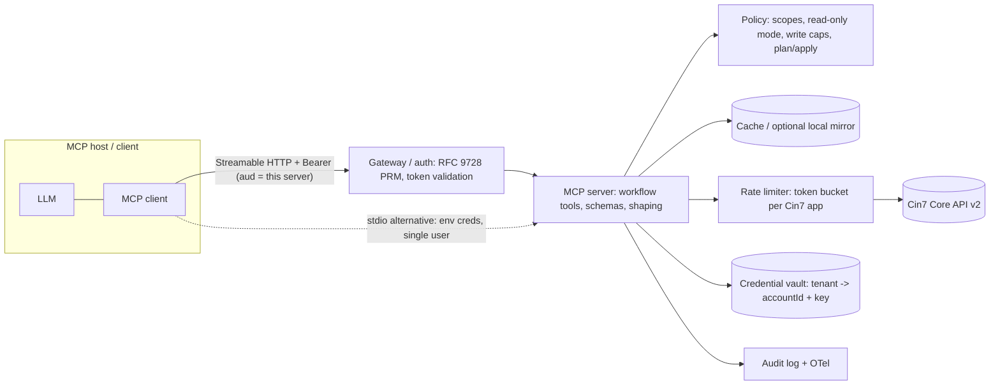

# MCP Landscape Reference (for a Cin7 Core MCP server)

Research date: 2026-11-05. Method: WebSearch + WebFetch against primary sources where reachable (modelcontextprotocol.io spec pages, SDK repos, vendor docs), plus secondary blogs where primary sources were unavailable. Confidence flags: **[P]** = read on a primary source this session; **[S]** = secondary/aggregator source, verify; **[M]** = from model background knowledge, not re-verified this session.

---

## 1. Current MCP spec

### 1.1 Revision timeline

| Revision | Notes |
|---|---|
| 2025-03-26 | Streamable HTTP introduced, HTTP+SSE deprecated; tool annotations **[M]** |
| 2025-06-18 | Structured tool output / `outputSchema`, elicitation, server = OAuth resource server (RFC 9728) **[M]** |
| 2025-11-25 | Experimental tasks, URL-mode elicitation, Client ID Metadata Documents (CIMD) **[M]**; the 2026 changelog confirms it as the previous revision [P] |
| **2026-07-28 (current)** | Largest change since launch: stateless core, MRTR, tasks to extension, deprecations. RC 2026-05-21 **[S]**, final 2026-07-28 |

Sources: [changelog 2026-07-28](https://modelcontextprotocol.io/specification/2026-07-28/changelog) [P], [release blog](https://blog.modelcontextprotocol.io/posts/2026-07-28/) [P], [AAIF migration post](https://aaif.io/blog/mcp-2026-07-28-whats-changing-and-how-to-migrate) [S].

### 1.2 What changed in 2026-07-28 (all [P], from the changelog)

- **No sessions, no handshake.** `initialize` and `Mcp-Session-Id` removed (SEP-2567, SEP-2575). Every request carries `_meta` with `io.modelcontextprotocol/protocolVersion`, `clientCapabilities`, optional `clientInfo`. New mandatory `server/discover` RPC. `ping`, `logging/setLevel` removed. Cross-call state = explicit server-minted handles passed as tool args (non-normative "Stateful Tools" guidance).
- **Multi Round-Trip Requests (MRTR, SEP-2322).** Servers no longer send `elicitation/create` / `sampling/createMessage` / `roots/list` mid-call. They return `resultType: "input_required"` with `inputRequests` and an opaque `requestState`; the client retries the same call (new JSON-RPC id) with `inputResponses`. Supported on `tools/call`, `prompts/get`, `resources/read`. `requestState` is attacker-controlled input: MUST be integrity protected (HMAC/AEAD) if it influences authz or logic; SHOULD bind principal + TTL + request digest.
- **All results carry `resultType`** (`complete`, `input_required`; tasks add `task`).
- **Tasks moved to an extension** `io.modelcontextprotocol/tasks` (SEP-2663): server decides to return a `CreateTaskResult` (taskId, status, `ttlMs`, `pollIntervalMs`); client polls `tasks/get`, answers input via `tasks/update`, can `tasks/cancel`; `tasks/list` removed; statuses working / input_required / completed / failed / cancelled. Client must declare support per request ([tasks overview](https://modelcontextprotocol.io/extensions/tasks/overview) [P]).
- **`subscriptions/listen`** replaces GET endpoint and resources/subscribe; list-changed notifications are opt-in.
- **SSE resumability removed** (no `Last-Event-ID`); a broken stream means re-issue as a new request.
- **Header routing (SEP-2243):** `Mcp-Method`, `Mcp-Name` required on HTTP POST; `x-mcp-header` lets a tool param be mirrored to `Mcp-Param-*` (do not use for secrets/PII).
- **Cacheable lists (SEP-2549):** `ttlMs` + `cacheScope` (public/private) required on `tools/list`, `prompts/list`, `resources/list`, `resources/read`, templates. Tools SHOULD be returned in deterministic order (helps LLM prompt caching).
- **Schemas:** `inputSchema`/`outputSchema` accept any JSON Schema 2020-12 keywords; `structuredContent` may be any JSON value, not only an object (SEP-2106).
- **OTel:** `traceparent`/`tracestate`/`baggage` conventions in `_meta` (SEP-414).
- **Error codes:** resource-not-found now -32602; -32020..-32099 reserved for spec.
- **Deprecated (12-month minimum window, SEP-2577/2596):** Roots, Sampling, Logging (use tool params / call the LLM directly / stderr or OTel); legacy HTTP+SSE transport; `includeContext` thisServer/allServers; **Dynamic Client Registration** (prefer CIMD).
- **Governance:** feature lifecycle + deprecated registry; extensions framework (Tasks, MCP Apps, Enterprise Managed Authorization listed as extensions per the release blog [P]).

Implication: **sampling and roots should not be designed around**. Elicitation survives via MRTR but is only usable if the client declares the `elicitation` capability.

### 1.3 Primitives

| Primitive | Status (2026-07-28) | Relevance to an ERP server |
|---|---|---|
| Tools (model-controlled) | Core | Primary surface |
| Resources / templates (app-controlled) | Core, cacheable | Reference data (e.g. warehouse list, a report snapshot); client support for resources is uneven **[M]** |
| Prompts (user-controlled) | Core | Canned workflows ("weekly reorder review") |
| Elicitation (form, URL) | Core via MRTR | Write confirmation, missing-parameter prompts |
| Tasks | Extension | Long-running syncs/reports |
| Sampling, Roots, Logging | **Deprecated** | Avoid |
| Completion, pagination, progress | Core | Pagination: cursor-based on list ops **[M]**; progress notifications are request-scoped on the response stream [P] |

### 1.4 Tools details [P unless noted] ([tools page](https://modelcontextprotocol.io/specification/2026-07-28/server/tools))

- Fields: `name` (1-128 chars, `[A-Za-z0-9_.-]`), `title`, `description`, `icons`, `inputSchema`, `outputSchema`, `annotations`.
- **Annotations** (`readOnlyHint`, `destructiveHint`, `idempotentHint`, `openWorldHint`, `title`) **[M for field list]**: the 2026 page only states that clients MUST treat annotations as **untrusted unless from a trusted server**. They are hints for UX/gating, not security controls. Spec defaults (destructive=true, idempotent=false, readOnly=false, openWorld=true) **[M]**, so set all explicitly.
- **Structured output:** `structuredContent` + optional `outputSchema`; if a schema is declared the server MUST conform; SHOULD also emit serialized JSON in a text block for back-compat.
- **Errors:** protocol errors (JSON-RPC: unknown tool, malformed) vs **tool execution errors** (`isError: true`) for API failures, validation, business rules; the latter are what LLMs can self-correct from.
- **Security section:** servers MUST validate inputs, enforce access control, rate limit, sanitize outputs; clients SHOULD confirm sensitive ops, show inputs, log.
- `tools/list` MAY vary by the presented authorization (e.g. hide tools not permitted by scopes) but MUST NOT vary per connection.

### 1.5 Transports

- **stdio**: credentials from environment, not OAuth (spec: stdio SHOULD NOT follow the authorization spec) [P].
- **Streamable HTTP**: single POST endpoint, stateless in 2026-07-28; required headers; HTTP+SSE deprecated [P].

### 1.6 Authorization [P] ([auth page](https://modelcontextprotocol.io/specification/2026-07-28/basic/authorization))

- MCP server = **OAuth 2.1 resource server**; MUST publish Protected Resource Metadata (RFC 9728); AS discovery via RFC 8414 or OIDC.
- Clients MUST send RFC 8707 `resource` param; server MUST validate token audience = itself; **no token passthrough**; PKCE; RFC 9207 `iss` validation (SEP-2468).
- Client registration: CIMD preferred; DCR deprecated; pre-registration allowed.
- Scopes: `WWW-Authenticate` `scope=` challenge, 403 `insufficient_scope` step-up; guidance to start minimal and elevate (useful for read vs write scopes).
- Extension list at [ext-auth](https://github.com/modelcontextprotocol/ext-auth).

---

## 2. SDKs

| SDK | State (as of 2026-11) | Validation | Notes |
|---|---|---|---|
| **TypeScript** `@modelcontextprotocol/server` / `client` (v2, `main`) | v2 is "the stable release line", implements 2026-07-28; v1 `@modelcontextprotocol/sdk` gets fixes >= 6 months after v2 (2026-07-27 per README) [P] | Standard Schema: Zod v4, Valibot, ArkType [P] | stdio + Streamable HTTP; adapters for Node, Express, Fastify, Hono (Host-header validation) [P]; Node/Bun/Deno |
| **Python** `mcp` v2 (`MCPServer`) | v2 stable reported around 2026-07-28 (b1 on 2026-06-30) [S, dates conflict]; README example uses `from mcp.server import MCPServer` [P] | Type hints (pydantic under the hood **[M]**); `structured_content` on client results [P] | v2 renamed bundled `FastMCP` to `MCPServer` [S]; stdio, Streamable HTTP, SSE |
| **FastMCP** (standalone, jlowin / Prefect) | Separate package, tracks spec ahead of official SDK **[M]**; one post says FastMCP 4 pulls `mcp` 2.x [S] | pydantic | Richest ergonomics: middleware, auth providers, proxying, testing client, composition **[M]**; the tzenderman Cin7 server uses it [P] |
| Go, C# | Support 2026-07-28 [P] | n/a | |
| Rust | Beta [P] | n/a | |

Trade-offs (judgement):
- **TypeScript**: first-class spec fidelity, best fit if hosting on Node/edge (Cloudflare, Hono), strong typing via Zod; ecosystem of inspector/eval tooling is TS-native.
- **Python/FastMCP**: fastest to a working server, nice decorators, in-memory test client, easy data-shaping (pandas); slightly more version-pairing risk (FastMCP vs `mcp` v1/v2 rename) [S].
- Testing: MCP Inspector (official, `npx @modelcontextprotocol/inspector`) **[M]**; FastMCP in-memory `Client(server)` **[M]**; TS: in-memory transport pair **[M]**. Neither SDK README fetched this session documented test helpers [P: not covered].
- Verify pins on PyPI/npm before committing; secondary sources disagree on versions.

---

## 3. Architecture patterns and best practices

### 3.1 Outcome-oriented tools, not endpoint mirroring

- Anthropic engineering ([Writing tools for agents, 2025-09-11](https://www.anthropic.com/engineering/writing-tools-for-agents)) [P]: consolidate multi-step flows into one tool; prefer search over list-all; namespace tool names; return human-readable fields over UUIDs; `response_format` concise/detailed (concise ~1/3 tokens in their example); pagination, filtering, truncation with defaults (Claude Code caps tool results at 25k tokens by default); errors that say what to fix with valid examples; evaluate with realistic multi-step tasks.
- Practitioner guides [S]: [Phil Schmid](https://www.philschmid.de/mcp-best-practices) (avoid 1:1 REST conversion; ~5-15 tools heuristic), [Shopware](https://developer.shopware.com/docs/products/tools/mcp-server/best-practices.html) (3+ calls for one intent = outcome-tool candidate; keep some generic tools), [Microsoft](https://microsoft.github.io/mcp-azure-security-guide/adoption/development-best-practices) (do not auto-generate from OpenAPI). The 5-15 figure is a rule of thumb, not a standard.
- **Counter-pattern worth knowing: search/describe/execute meta-tools.** Stripe exposes `stripe_api_search`, `stripe_api_details`, `stripe_api_read`, `stripe_api_write` to cover a huge API without bloating context [P]; `cin7-core-cli` MCP does the same read-only (`search_operations`, `describe_operation`, `read`) [P]. Trade-off: tiny context footprint and full coverage, but the model must plan API calls, and generic write tools are hard to annotate/gate (Stripe gates by action server-side, "Human confirmation" badge).

### 3.2 Tool count and context budget

Each tool definition costs tokens on every turn; deterministic `tools/list` ordering (new in spec) helps prompt-cache hits; authz-dependent `tools/list` lets a read-only token see only read tools. Large `outputSchema`s also cost context in clients that surface them **[M]**.

### 3.3 Response shaping

- Default to summaries + key fields; offer `detail`/`fields` params; hard cap row counts and return `has_more` / `next_cursor` / `total_count` and an explicit "showing N of M, refine with X" hint.
- Return both text (concise, LLM-readable) and `structuredContent` (typed).
- Resolve IDs to names/SKUs; return units, currency, timezone explicitly.
- For heavy data, write a snapshot and return a handle/resource link (tzenderman's Cin7 server uses snapshot start/status/chunk/close tools for large catalogs [P]).

### 3.4 Write safety

Layered options (not mutually exclusive):
1. **Scope/mode**: read-only mode by env flag or by OAuth scope; hide write tools from `tools/list` when not permitted.
2. **Drafts**: create documents in a Draft/non-posted state (tzenderman always creates POs as DRAFT [P]).
3. **Dry-run / plan-apply**: tool 1 validates and returns a diff + opaque signed `plan_id`; tool 2 applies. Fits the stateless model (handles; `requestState`-style HMAC with principal+TTL+digest [P]).
4. **Elicitation (MRTR)** for confirmation: server returns `input_required` with a confirm form; client retries. Requires client `elicitation` capability; many clients lack it **[M]**, so need a fallback (plan/apply).
5. **Out-of-band approval**: Stripe's pattern, a URL the human opens in the dashboard, returning an approval token, 24h expiry [P].
6. **Idempotency**: client-supplied `idempotency_key` stored server-side; natural-key checks (e.g. reference number already exists) since Cin7 API idempotency is not documented **[unverified]**.
7. **Annotations** set truthfully, but treat as UX only (spec says untrusted).
8. Limits: max lines/qty/value per call, audit log of every write.

### 3.5 Rate limits and caching for a rate-limited upstream

- Cin7 Core: reported **60 calls/min per API application** [S: several sources + [ebragas README](https://github.com/ebragas/cin7-mcp)]; 429 on v2 (503 on legacy) [S]; pagination via `Page`/`Limit` only on some list endpoints (Product, SaleList, PurchaseList...) [S: [mindcloud docs](https://mindcloud.co/docs/universal/rest/cin7-core/latest/introduction/requests), Dear docs via search]. **Confirm in official docs before design.**
- Patterns: central token-bucket limiter (cin7-core-cli paces at 40/min default, retries 429 up to 4x honouring `Retry-After` [P]); per-tenant budgets; request coalescing; TTL caches for slow-changing data (products, locations, suppliers); short TTL or none for stock/availability; return `data_as_of` timestamps so the LLM can reason about freshness; surface "rate limited, retry in Ns" as a tool execution error.
- A local mirror/snapshot (SQLite/Postgres) with incremental sync trades freshness for query power and rate-limit relief; enables analytic tools impossible via REST (joins, aggregates). Cost: sync complexity, staleness, PII/data residency.
- Spec-level: `ttlMs`/`cacheScope` on list results only; no spec caching for tool results.

### 3.6 Errors for LLMs

Use `isError: true` with: what failed, why, what to try (valid enum values, example call), whether retryable and when (`retry_after_s`), and never raw stack traces or upstream secrets. Reserve JSON-RPC errors for protocol problems [P].

### 3.7 Deployment

| | Local stdio | Remote Streamable HTTP |
|---|---|---|
| Auth | Env credentials [P: spec says stdio uses environment] | OAuth 2.1 RS + AS (own or IdP like ScaleKit, as in tzenderman [P]) |
| Credential exposure | On user's machine | Server holds upstream key; must be vaulted |
| Multi-tenant | N/A (one user) | Required: map token principal -> tenant -> Cin7 account ID + key |
| Rate-limit budget | Per user key | Shared per Cin7 app/account; central limiter essential |
| Ops | `uvx`/`npx` install, supply-chain risk | Scaling, secrets, observability; stateless protocol now simplifies horizontal scale |
| Client reach | Desktop/IDE clients | Web connectors (Claude, ChatGPT), enterprise admin controls |

Note Cin7 Core uses account-id + application-key headers, not OAuth **[S/M]**, so a remote server is an OAuth RS in front of a static-key upstream: the **user's token must not be passed through**; the server maps identity to stored upstream credentials (spec forbids token passthrough [P]).

### 3.8 Observability and testing

- Observability: OTel trace context via `_meta` [P]; per-tool latency/error/upstream-429 metrics; structured audit log (principal, tool, args hash, upstream calls, result); Stripe offers MCP tool-call logs in Workbench as a reference [P].
- Testing pyramid: unit tests of shaping/validation; contract tests with recorded Cin7 fixtures (and a sandbox account); in-process MCP client integration tests; MCP Inspector for manual checks **[M]**; **agent evals** per Anthropic guidance (realistic multi-step tasks, verifiable answers, transcript review, track tool-call count/errors, held-out set) [P]. Include adversarial evals (injection in free-text fields).

---

## 4. Existing ERP / inventory / commerce MCP servers

### 4.1 Cin7 Core / DEAR (explicit search)

No official Cin7 MCP server found [S: search results show only third-party]. Third-party landscape:

| Project | Type | Surface | Notes |
|---|---|---|---|
| [tzenderman/mcp-cin7-core](https://github.com/tzenderman/mcp-cin7-core) [P] | FastMCP, stdio + Streamable HTTP w/ OAuth (ScaleKit), MIT | ~30 tools: status/me; products, suppliers, sales, purchases (list/get/create/update mostly), stock levels, stock transfers; snapshot start/status/chunk/close for big catalogs | Largely endpoint-mirroring CRUD; write safety = POs created as DRAFT only; no rate-limit handling documented; 1 star, early |
| [tzenderman/mcp-cin7-meta](https://glama.ai/mcp/servers/tzenderman/mcp-cin7-meta) [S] | Sibling | 4 generic tools covering whole REST API | Meta-tool pattern |
| [ebragas/cin7-mcp](https://github.com/ebragas/cin7-mcp) [P] | Read-only | `get_stock_levels`, `list_purchases`, `get_purchase` | Tiny; 60 rpm noted; no backoff/cache; "early version", 0 stars |
| [fightmilk808/cin7-core-cli](https://github.com/fightmilk808/cin7-core-cli) [P] | CLI + MCP, read-only default | `search_operations`, `describe_operation`, `page_operations`, `list_groups`, `auth_status`, `read` (GET only, 200-row cap) | Best-considered safety/rate-limit story: shared pacing (40/min default, <=60), 429 retry honouring Retry-After; writes never via MCP; CLI writes need 3 gates |
| [SyncHub](https://www.synchub.io/connectors/dearinventory/knowledge-base/mcp) [S] | Hosted, OAuth | Replicated-data access (SyncHub is a data-replication product, so likely a warehouse-style query surface; unverified) | Likely avoids live-API rate limits via replication |
| Zapier / viaSocket [S] | No-code action connectors | Create sale, stock adjustment, find products, create PO... | Action-per-endpoint |

Gap observed: none found with workflow/outcome tools (e.g. reorder planning, stock reconciliation, fulfilment exceptions), mirrored-data analytics, structured outputs, tasks, or plan/apply write safety. **[Inference from limited search; not exhaustive.]**

### 4.2 Other platforms

| Platform | What it exposes | Notable pattern | Confidence |
|---|---|---|---|
| **Stripe** (`mcp.stripe.com`) [P] ([docs](https://docs.stripe.com/mcp)) | ~15 named tools + generic `stripe_api_search/details/read/write`; Atlas, analytics, Treasury | OAuth (per-environment grants, revocable sessions) or **agent API keys** (full-access/untagged restricted keys rejected from Dec 2026); server-side "Human confirmation" for risky actions via dashboard URL + approval token; admin kill switch; warns re prompt injection when combined with other servers | High |
| **Shopify** [P partial] | Dev MCP (`@shopify/dev-mcp`): local, no auth, docs/schema tooling, not store data | Other Shopify MCP servers (Storefront etc.) claimed by aggregator [S] but not verified | Low |
| **Xero** [S] ([dev blog](https://devblog.xero.com/the-xero-remote-mcp-is-now-generally-available-06008f6ab2a7?gi=168b8f1ab02d)) | Official Remote MCP GA (PKCE); tool counts conflict between sources (20 read-only vs 39 read/write); OSS local `XeroAPI/xero-mcp-server` (stdio) | Official remote + OSS local pair | Medium-low |
| **QuickBooks** [S] | Intuit-org local server with create/update/delete tools switchable off | Per-verb disable switches | Low |
| **NetSuite** [S] | Oracle "AI Connector Service" + MCP Standard Tools SuiteApp; client support reported limited | Vendor-hosted | Low |
| **Odoo** [S] | Community servers (e.g. ivnvxd/mcp-server-odoo); reports of a native MCP endpoint in newer Odoo releases (versions conflict: 19.4 vs 20) with a few read tools by default | Opt-in exposure of tools | Low |
| **SAP** [S] | Sample MCP code for Business One; no single official server confirmed | Self-hosted samples | Low |

Takeaways: the vendor-official examples that look most mature (Stripe) combine **small curated set + generic escape hatch + server-side gating + scoped credentials**; many ERP community servers are CRUD wrappers.

---

## 5. Security

| Threat | Description | Mitigations / notes |
|---|---|---|
| **Indirect prompt injection via ERP data** | Free-text fields (product descriptions, customer notes, supplier names, PO/sale comments, attachment names, order memos) are attacker-influenced (e.g. a customer or supplier portal entry) and flow into the LLM | Treat all upstream strings as untrusted; return them in clearly delimited fields; truncate/strip long free-text by default (opt-in `include_notes`); never put upstream text in tool descriptions or error messages unescaped; keep write tools behind confirmation so injected text cannot silently act; no single filter works [S: [aptible](https://www.aptible.com/mcp-security/mcp-prompt-injection), [Scalar](https://scalar.com/learn/mcp/mcp-server-security)] |
| **Lethal trifecta** (private data + untrusted content + exfil channel) | Simon Willison's framing via [S] secondary guides | ERP server holds private data and untrusted content; avoid adding outbound channels (no arbitrary URL fetch/email tools in same server); document guidance to users about combining with web/email servers (Stripe does the same [P]) |
| **Tool poisoning / rug pull** | Malicious or changed tool descriptions | Matters mainly for users installing our server; ship signed/pinned releases; keep descriptions static; clients should hash/pin [S] |
| **Confused deputy / token passthrough** | Proxy servers with static client IDs; accepting tokens not issued for the server | Spec: per-client consent, exact redirect URI match, state handling; MUST NOT accept tokens not issued for the server; audience validation [P: [security best practices](https://modelcontextprotocol.io/specification/2026-07-28/basic/security_best_practices)]. Relevant if we front a third-party IdP |
| **State handle hijacking** | Guessable handles (snapshots, plan IDs) | Random handles bound to `<user_id>:<handle>`, expiry [P] |
| **requestState tampering** | MRTR state is client-held | HMAC/AEAD + principal + TTL + request digest; enforce single-use server-side for one-time ops [P] |
| **SSRF** | Mostly client/AS-side; relevant if server fetches URLs | Block private ranges, egress proxy [P] |
| **Local server compromise** | stdio servers run with user privileges; supply-chain | Minimal deps, pinned installs, restrict filesystem/network; prefer stdio over open localhost HTTP, or require token [P] |
| **Scope minimization** | Omnibus scopes | Separate `cin7:read` / `cin7:write` (/`cin7:admin`), step-up on first write [P] |
| **Credential handling** | Cin7 account id + application key are long-lived static secrets | Env/secret manager only; never log or echo; per-tenant encryption at rest; rotate; `auth_status`-style tool that reports source but not value (cin7-core-cli [P]); Cin7 permission set of the API application is the real least-privilege boundary (use a restricted Cin7 API user) **[M]** |
| **Least privilege / read-only** | | Read-only default (cin7-core-cli [P]); write tools only registered when enabled; annotations set but not trusted [P] |

---

## 6. Implications and candidate architectural directions (options only)

**Implications**
1. The spec is now stateless and MRTR-based; old assumptions (sessions, server-initiated elicitation, sampling, roots) are gone or deprecated. Design for per-request context and explicit handles.
2. The existing Cin7 MCP field is thin: CRUD mirrors and read-only getters; the differentiator is in the problem solved, workflow tools, and safety/rate-limit engineering.
3. 60 rpm/app upstream limit makes rate-limit budgeting and caching first-order architecture concerns, particularly if remote/multi-tenant.
4. Write safety needs a fallback that works without client elicitation support.
5. ERP free-text is an injection vector; response shaping is also a security control.

**Candidate directions**

| Option | Sketch | Pros | Cons |
|---|---|---|---|
| A. Workflow tools, live API | 5-12 outcome tools over Cin7 REST with limiter + TTL cache | Simple, always fresh, small context | Rate limit bounds complexity of analytic tools; many-call workflows slow |
| B. Mirror + query | Incremental sync to local store; tools query mirror (and maybe one generic read-only query/search tool) | Rich analytics, no rate pressure on reads, fast | Staleness, sync complexity, deletion detection, data residency |
| C. Hybrid | Mirror for analysis, live API for point lookups and all writes | Best fit for "analyse then act" | Most moving parts |
| D. Meta-tool (search/describe/execute) | Stripe/cin7-core-cli style | Full coverage, tiny context | Not outcome-oriented; harder write gating; model must plan |
| E. Curated tools + read-only generic escape hatch | A plus one GET-only `cin7_read` | Flexibility with safe default | Escape hatch invites large/injection-prone payloads |
| Write model | (i) read-only only; (ii) draft-only creation; (iii) plan/apply with signed plan; (iv) MRTR elicitation with plan/apply fallback; (v) out-of-band approval URL | | Choose by risk appetite |
| Deployment | (a) stdio single-tenant (fastest); (b) remote single-tenant behind OAuth; (c) remote multi-tenant with vaulted keys | | (c) needs tenant isolation, limiter per Cin7 app, audit |
| Long operations | Tasks extension for syncs/bulk ops vs snapshot-handle tools (works on all clients today) | | Tasks client support varies [P: client matrix referenced, not inspected] |
| SDK | TypeScript v2 (Zod/Standard Schema) vs Python (`mcp` v2 / FastMCP) | | See section 2; decision likely driven by team skills and hosting target |

**Open questions**
1. Which concrete problem (e.g. reorder/replenishment, stock discrepancy, order-fulfilment exceptions, supplier lead-time analysis, reporting/finance close) and who is the user: operator in Claude Desktop, internal agent, or customers via a hosted connector?
2. Read-only analysis only, or are writes in scope in v1? Which writes?
3. Official Cin7 Core API facts to confirm: exact rate limit and 429/503 behaviour, max page size, idempotency support, webhooks availability (would enable incremental sync), API application permission granularity, sandbox/demo account.
4. Single-tenant (own company) or multi-tenant product? Data residency/PII constraints on mirroring?
5. Target clients and their support for elicitation, structured output, resources, tasks (client matrix not inspected).
6. Evals: what ground-truth questions and datasets exist for success measurement?
7. Verify SDK version pins and the Python `FastMCP` vs `MCPServer` situation on PyPI before starting.

---

## Sources and confidence notes

Primary (read this session): MCP spec 2026-07-28 changelog, tools, authorization, MRTR, security best practices; MCP release blog; tasks extension overview; TypeScript and Python SDK READMEs; Stripe MCP docs; Anthropic "Writing tools for agents"; GitHub READMEs of tzenderman/mcp-cin7-core, ebragas/cin7-mcp, fightmilk808/cin7-core-cli.
Secondary / unverified: Xero, Shopify, QuickBooks, NetSuite, Odoo, SAP details; Python SDK v2 dates and FastMCP pairing; Cin7 rate limit/pagination details; SyncHub, Zapier, viaSocket capabilities; security-vendor blog claims; arXiv study of client security ([2603.21642](https://arxiv.org/html/2603.21642v1)).
Not verified at all (from background knowledge): annotation field defaults, Inspector usage, 2025 revision feature attribution, SDK test helpers.
