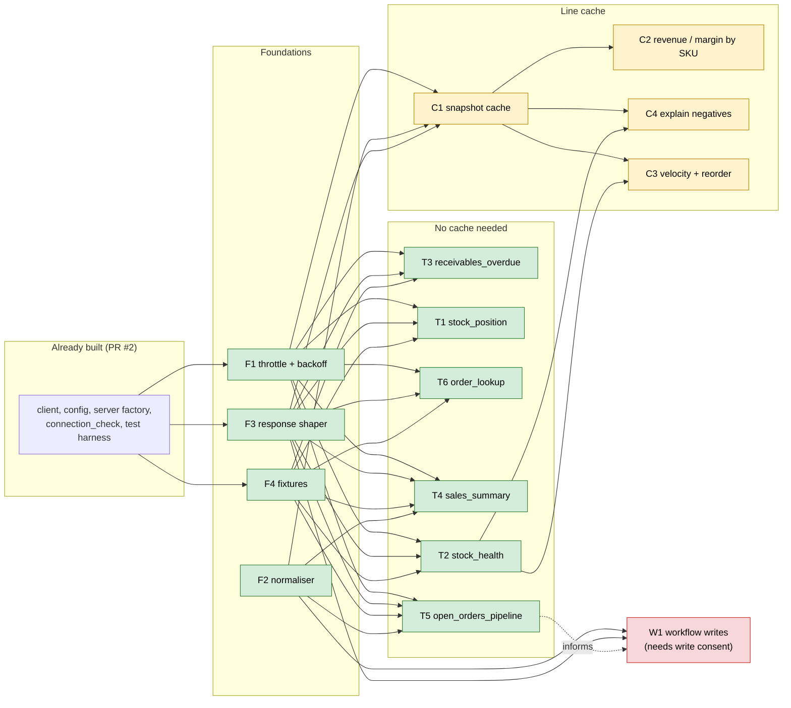

# Prioritisation: value vs implementation effort

Ranks **buildable items** (tools and foundations), not the five candidates, because candidates 1 and 2 share one data plane and the cost sits in shared pieces. Inputs: [sandbox-findings.md](sandbox-findings.md), [user-complaints.md](user-complaints.md), [cin7-core-api.md](cin7-core-api.md) §7. Date 2026-11-05.

## 1. Findings that shape the ranking

1. **Most visible value ships without the line cache.** Questions split by the data they need:

| Question | Data needed | Calls (sandbox) |
|---|---|---|
| Overdue receivables, unpaid totals | Sale headers (`InvoiceAmount`, `PaidAmount`, `InvoiceDueDate`) | 2 |
| Sales by period / channel / customer | Sale headers (`OrderDate`, `SourceChannel`, `CustomerID`, `InvoiceAmount`) | 2 |
| Open-order pipeline by stage | Sale + purchase headers (sub-statuses + `Type`) | 3-4 |
| Stock position and valuation | Availability (`StockOnHand` is value) | 1 |
| Stock-health detection | Availability, plus product reorder thresholds | 1 + 2-16 |
| One order, shaped | One detail call | 1 |
| **Revenue by SKU, margin, velocity** | **Sale lines (detail only; `COGSAmount` detail-only)** | **173+ (about 3 min)** |
| **Explain negative availability** | **Lines of open orders** | **up to ~114** |

   Six read tools answer from headers or availability. Only SKU-level revenue/margin, velocity and the explanation step need the cache. So the **cache moves out of the MVP**.
2. **Incremental refresh is viable.** Spike (call 23): `saleList?UpdatedSince=2026-10-15` returned `Total` 15, exactly the 15 rows the local copy predicted, all on or after the cutoff. The cache's cost case holds; detail has no such filter, so only changed sales are re-fetched.
3. **Already built** on `feat/typescript-scaffold` (PR #2, unmerged): HTTP client (auth, error mapping, 57 lines), config loader, server factory, `cin7_connection_check`, vitest in-memory harness. Not counted below.

## 2. Rubric

- **Value, 1-3, ordinal**, from: complaint evidence ([user-complaints.md](user-complaints.md) IDs), how many questions it answers, reuse by later items. **This is the weakest input**: public complaints are generic and the sandbox is synthetic. Treat values as a prior to be overwritten by the user's top pain (see §6).
- **Effort, S / M / L**, from named drivers: calls and pages per use; needs normaliser or cache; PII surface; write risk; fixtures; live verification under 60 calls/min.
  - **Fixtures are real work for every tool**: raw sandbox bodies cannot be committed (customer data), so each tool needs synthetic fixtures built from the observed shapes ([observed-entities.md](../design/observed-entities.md)).
- **Work item (WI)** = one Haiku-sized task (one module plus tests) followed by a review pass. S = 1 WI, M = 2-3 WI, L = 4-6 WI. Ratios use S=1, M=2, L=3.

## 3. Items

| ID | Item | Value | Why (value) | Effort | Drivers (effort) | Depends on | Risk |
|---|---|---|---|---|---|---|---|
| F1 | Throttle (60/min) + 429 backoff in `src/cin7/client.ts` | enabler | every tool needs it | S | one module, clock-mockable tests | - | low |
| F2 | Normaliser: list/detail field drift, workflow stage from `Type` + sub-statuses | enabler | status trap is real (9 of 85 ORDERED are shipped Advanced sales) | M | mapping tables, many edge cases | - | medium (semantics) |
| F3 | Response shaper: PII mask, token budget, "data as of" stamp | enabler | sale detail carries email, phone, addresses | M | masking rules, size caps | - | medium (privacy) |
| F4 | Synthetic fixture builder from observed shapes | enabler | tests for all tools | M | shapes for sales, purchases, availability, products | - | low |
| T3 | `receivables_overdue` | 3 | classic report with no Cin7 endpoint; C9/E3; cheap | S | 2 list calls, simple maths | F1, F3, F4 | low |
| T1 | `stock_position` (valuation by location/product) | 2 | answers a common ask; `StockOnHand` is value (empirical) | S | 1 call; value claim only empirically verified | F1, F3, F4 | low |
| T6 | `order_lookup` (shaped single order) | 2 | every analysis ends with "show me that order"; PII showcase | S | 1 detail call, mask PII | F1, F3, F4 | low |
| T4 | `sales_summary` by period / channel / customer | 3 | core of the reporting gap (C9/E3), broad question coverage | M | paging (2 calls/173), date windows, aggregation, credit-note semantics (`InvoiceAmount` is net of credit notes) | F1-F4 | medium |
| T2 | `stock_health` (negatives, on-order-at-zero, below reorder point) | 3 | stock drift is the highest-severity theme (C4/E2); folds in candidate 4's threshold check | M | availability + product thresholds (2-16 calls, 233 KB per 100 products), thresholds change rarely | F1-F4 | medium (thresholds, formula-mismatch rows unexplained) |
| T5 | `open_orders_pipeline` (stage counts, stuck stages) | 2 | complexity/learning curve (C10/E8); needs F2 | M | sale + purchase lists, stage derivation | F1-F4 | medium (status semantics) |
| C1 | Snapshot cache, `UpdatedSince` incremental refresh | 2 | enabler for line-level items | L | storage choice, refresh policy, progress on first load (minutes), invalidation, tests | F1-F4 | **high** (scale unknown) |
| C2 | Revenue and margin by SKU/customer | 3 | the "real" reporting gap; margin needs `COGSAmount` | M | aggregation over cached lines | C1 | medium |
| C4 | Explain negative availability | 2 | turns detection into answers | M | trace allocations over cached lines | C1, T2 | medium |
| C3 | Velocity + reorder suggestions | 2 | weak evidence (E10: one reviewer) | M | velocity over cached lines + thresholds | C1, T2 | medium |
| W1 | Workflow writes (advance stage, receive PO) | 3 (conditional) | complexity pain, but unproven | L | stage gating, void/undo overload, no idempotency keys, confirmation/dry-run design; **needs fresh write consent** | F1-F3, F2 | **high** |
| X | Accounting reconciliation | - | **excluded**: no sync fields, no accounting-side access | - | - | - | - |

## 4. Dependencies

## 5. Ranked build sequence and cut lines

Rank by value per effort, adjusted for dependencies (an item that needs the cache carries the cache's cost).

| Rank | Item | Value / effort | Note |
|---|---|---|---|
| 1 | F1 + F3 + F4 (minimal) | enabler | serial blockers; F4 can start with availability and sale-list fixtures only |
| 2 | T3 receivables_overdue | 3 / S | highest ratio, easiest proof of the shaped-output pattern |
| 3 | T1 stock_position | 2 / S | one call |
| 4 | T6 order_lookup | 2 / S | PII masking in practice |
| 5 | F2 normaliser | enabler | before T4/T5 |
| 6 | T4 sales_summary | 3 / M | broad reporting coverage |
| 7 | T2 stock_health | 3 / M | highest-severity theme |
| 8 | T5 open_orders_pipeline | 2 / M | |
| 9 | C1 snapshot cache | 2 / L | first real risk; decide after 1-8 show what users ask for |
| 10 | C2 revenue and margin by SKU | 3 / M after C1 | effective effort L+M |
| 11 | C4 explain negatives | 2 / M after C1 | |
| 12 | C3 velocity + reorder | 2 / M after C1 | weakest evidence |
| 13 | W1 workflow writes | 3? / L | separate decision, separate consent |

**Cut lines** (work-item counts are the estimate; elapsed time depends on the assumptions below):

| Time box | Ships | Approx. WI | What the user can do |
|---|---|---|---|
| About 1 day | F1, F3, F4 (minimal), T3, T1, T6 | about 8 | overdue receivables, stock valuation, one shaped order, with throttling and PII masking |
| About 3 days | + F2, T4, T2, T5 | about 17 | sales summaries, stock health (with thresholds), order pipeline: the whole no-cache MVP |
| About 1 week | + C1, C2 (+ C4) | about 30 | SKU-level revenue/margin, explained stock discrepancies; first load takes minutes |
| Not in a week | W1 workflows | 4-6 + design | needs consent and a confirmation design |

**Assumptions behind the time boxes** (an estimate, not a measurement): up to 5 Haiku agents in parallel; foundations (F1-F4) are a serial first wave; each work item about one focused agent run plus a review pass by the main model; live checks run at about 1 call per 1.2 s; the user merges PRs promptly. **The real bottleneck may be merge cadence:** five PRs are already open and stacked (#1-#5), and this would be the sixth, so unmerged review queue, not coding, may set the pace.

## 6. Sensitivity: what if the top pain is different?

| If the team's top pain is... | Top three change to | Effect |
|---|---|---|
| "We can't get reports" | T3, T4, then C2 | cache (C1) moves up; margin by SKU becomes the headline |
| "Our stock numbers are wrong" | T2, T1, then C4 | T2 first; C1 earlier so negatives can be explained |
| "Order processing is slow / error-prone" | T5, T6, then W1 | workflow assistant moves forward, but needs write consent and the highest risk |
| "Reorder / purchasing" | T2, C3, T1 | velocity needs the cache; evidence for this pain is weakest |

Default order (§5) assumes the reporting-and-stock pain, which has the most complaint evidence. It is a prior, not a finding.

## 7. Method and limits

- Desk analysis of existing findings plus one spike call (23 calls total in the sandbox investigation). Effort values are judgement, not measurement; there is no velocity data from past work on this repo.
- Value is ordinal and partly circular: it leans on complaint evidence that is thin ([user-complaints.md §1](user-complaints.md)). The sensitivity table shows how fragile the top three are.
- Fixture and live-verification costs are included in effort, but unknown unknowns (status semantics, `Available` formula mismatches, production scale) are not.

## 8. Inputs that would change this ranking

1. The time box (1 day, 3 days, 1 week, or open).
2. The team's top pain (reports, stock accuracy, order processing, purchasing).
3. Production scale (sales and products count) and whether the Automation add-on exists.
4. Whether write tools are wanted, and consent to test them in the sandbox.
