# Workflow guide: how we build this project with Claude Code

For new developers. It explains how work gets done here: the loop, the roles of the models, the conventions, and the mistakes we have already made so you can skip them. **This is a living document**: update it whenever the way we work changes (see [Update log](#update-log)).

Sources: this project's own history (2026-11-05 onwards) plus patterns from a Claude Code usage review (`/insights`) of the author's wider work. Project-specific internals from other work are deliberately left out.

## 1. The idea in one paragraph

The human sets direction and judges outcomes; Claude does the research, planning, building and checking, with stronger models planning and reviewing and cheap models implementing. Every step leaves a durable trail (docs, ADRs, PRs, numbers), nothing is "done" until it has been verified against something real, and the human reviews and merges everything.

## 2. The loop

```mermaid
flowchart LR
    A["Question or goal"] --> B["Research and docs<br/>(parallel agents)"]
    B --> C["Plan mode<br/>write plan, approve"]
    C --> D["Advisor gate<br/>before committing to an approach"]
    D --> E["Shared pieces by the main model"]
    E --> F["Haiku agents implement<br/>(max 5, own files)"]
    F --> G["Main model reviews diffs,<br/>full checks"]
    G --> H["Live gate<br/>real system, independent check"]
    H --> I["Evaluate against a<br/>pre-set kill criterion"]
    I --> J["Commit, push, PR<br/>human reviews and merges"]
    J -->|"findings change the plan"| C
```



How it played out here: research docs (Cin7 API, MCP landscape, user complaints) → sandbox investigation with a call budget and advisor gates → value-vs-effort prioritisation → MVP built by Haiku agents → A/B evaluation against a pre-registered kill criterion → ADR 0003.

## 3. Roles

| Role | Used for |
|---|---|
| Opus (plan mode) | Planning, architecture, judgement calls |
| Sonnet (main session) | Day-to-day work, shared code, reviewing diffs, integration |
| Haiku subagents (`model: haiku`, **max 5 at once**) | Implementing well-specified work items, one file or module each |
| Advisor (stronger reviewer) | Called before committing to an approach, when stuck, and before declaring done; it sees the whole conversation |
| Explore / general-purpose agents | Research and sweeping reads in the background |
| You | Direction, consent for data access and spend, review, merge |

## 4. Conventions

- **Terse replies.** `CLAUDE.md` asks Claude to prefer the `caveman` skill for chat; code, commits and docs are written normally.
- **Plan mode first** for anything non-trivial: Claude writes a plan, you approve it, then it builds. Re-plan when findings change the picture.
- **Git:** never commit to `master`. Feature branches, always commit **and push**; open PRs (stacked branches target their parent). Stage by **explicit path**, not `git add -A`, because the working tree may hold untracked scratch files, IDE config or local secrets. You review and merge.
- **Decisions** go to ADRs (`docs/adr/`), small "why" notes to `docs/justifications.md`, terms to `docs/glossary.md`, diagrams (mermaid) to `docs/design/`.
- **Secrets:** the Cin7 key lives only in the gitignored `.env`. The server loads it itself, so the model never needs it. Credentials never go in committed files, docs or transcripts.
- **Privacy:** docs and commits carry counts, shapes and distributions, never customer or supplier data. Raw API bodies and eval transcripts stay in the (gitignored) scratch area or `eval/out/`.
- **Consent for data and spend.** Sandbox access and any paid runs (such as headless evaluation) are agreed first; calls are read-only unless writes are explicitly allowed, and kept small and justified.
- **Update the docs when you learn something**, including corrections to earlier docs (the API reference has a "verified against the sandbox" section for exactly this).

## 5. Delegating to Haiku agents

What worked: the main model writes the shared pieces first (helpers, retry/pacing, stubs, registration slots), then briefs one agent per tool or module, each owning **one source file and one test file**, then reviews every diff.

A good brief says:
1. The exact files the agent owns, and that others are editing other files at the same time.
2. The tool contract: name, inputs, data source, definitions, and the output shape.
3. Repo-specific traps. Here: **MCP SDK v2** (copy `src/tools/connection-check.ts` and `test/server.test.ts`; never import the v1 `@modelcontextprotocol/sdk`).
4. Limits: no `npm install`, no live API calls, don't read `.env`, run Biome and vitest **only on your own files** (never a tree-wide `--write`), no git commands.
5. Synthetic fixtures only, with named edge cases to test.

What review caught: Haiku typed customer IDs as numbers (real Cin7 IDs are GUID strings), which would have rejected every live response. The brief had not stated the type. **State data types in the brief, and always run a live check.**

## 6. What "done" means (preflight)

Local green is not done. Before any commit or PR:

```bash
npm run typecheck && npm run lint && npm test && npm run build
```

then the checks that tests cannot give you:

- **Live gate:** run the real server against the sandbox and compare numbers with an independent calculation (done for every tool; results matched ground truth).
- **Wiring:** `claude mcp list` shows the server; project-scoped servers need a one-time approval, which only you can give.
- **Privacy scan:** grep new docs for emails, GUIDs and key strings.
- **Staging check:** `git status` and explicit paths; nothing from `eval/out/`, `.env` or `http/*.private*`.
- **List what is still unverified** in the PR description, so reviewers do not assume it was checked.

When a claim matters, test it against a **pre-registered kill criterion** rather than judging it afterwards (see `eval/README.md`).

## 7. Lessons from this project (so you do not repeat them)

| What happened | Rule |
|---|---|
| Docs were committed straight to local `master` | Branch before the first commit; move stray commits to a branch |
| Real credentials were put into a tracked, non-ignored file | Secrets only in gitignored files; check `git check-ignore` before committing config |
| Public review sites (G2, Capterra, Reddit) could not be fetched, so research rested on snippets and competitor blogs | State method limits in the doc; mark biased and unverified sources |
| The sandbox is synthetic (bursty dates, everything overdue) | Use it as evidence of feasibility and cost, not of how common a pain is |
| Docs said one field name, the live API used another | Verify against the real system and record corrections |
| The write-up almost called anomalies "confirmed" | Keep pain evidence and feasibility in separate columns |
| An exact-label grader would have scored correct baseline answers wrong (for example "None" vs "(none)"), biasing the eval toward the MCP | Make graders label-agnostic and smoke-test the harness before spending |
| A narrow tool declined an out-of-scope question | Coverage is the product; plan which questions you must answer |
| Stacked PRs merged into their parent branches, so `master` missed the work twice and a consolidation round was needed | Base every branch on `origin/master` and open one PR per change straight into `master`; avoid stacks unless the parent merges first |
| An eval's ground truth was computed from the same list fields the tool reads, so it could not catch the tool being wrong (the list rollups disagree with documents on about 30% of sales) | Build truth from an independent source (documents, not rollups); say what a "correct" grade actually tests; re-check headline claims when new evidence arrives |
| An assumption ("line totals are ex-tax") held on only 100 of 164 invoices and would have shipped as a bug; splitting the check by tax mode on raw data found the inclusive-pricing exception first | Verify definitions against raw data, split by the obvious variants, before writing code that depends on them |
| A long chat is the only record of rules, consents, side effects and unanswered questions | Retire it with the `retire-chat` skill: repo facts are verified by script, the rest through a user-request ledger, an open-work register and a reviewer pass; test such tooling with a cold-start agent |
| Haiku typed Cin7 ids as numbers (real ids are GUID strings) | Put verified field facts and shared row types in the brief and the repo (`src/cin7/types.ts`); live-check every tool |

## 8. Habits worth keeping (from the usage review)

- **Define verification first.** Ask up front: which command, log or screenshot proves this works? End with a list of what remains unverified.
- **Review → plan → implement → independently verify** was the most reliable sequence in the review, and it is the one used here.
- **Prefer evidence over guesses:** reproduce, then fix; hand reproducible evidence to a maintainer instead of working around their bug.
- **State constraints at the start** ("investigate only, no edits", "project-scoped only", "do not touch generated files").
- **Automate the checks that keep biting.** Candidates for this repo: a post-edit hook that runs Biome on changed files; a `/preflight` skill wrapping section 6. Not set up yet.
- **Check external dependencies first** (credentials, approvals, a connected browser) before starting a task that depends on them.

## 9. Your first hour

1. Read `README.md`, then `CLAUDE.md`, then this guide.
2. `npm install`, copy `.env.example` to `.env`, `npm run build`, `npm test`.
3. Read `docs/adr/` in order, then skim the research under `docs/research/`.
4. Run `claude` in the repo, approve the `cin7-core` server, and ask it something an MCP tool should answer (for example overdue receivables as of today).
5. Pick a small change, start in plan mode, and follow the loop in section 2.

## Update log

| Date | Change |
|---|---|
| 2026-11-06 | Correction: eval truth for Q1-Q3 shared the tool's list-rollup basis; headline correctness reframed, tool wording fixed (PR `fix/list-basis-wording`). |
| 2026-11-06 | Retiring a chat: user-level `retire-chat` skill (collector, verifier, ADR progress writer) produces dated handoff documents in `docs/handoff/`; a cold-start agent test found real defects in the skill before it was relied on. |
| 2026-11-06 | Cache build: definition checks on raw data before coding (caught tax-inclusive line totals, non-base currencies, document dates); pre-registered Q11 with cold/warm runs; main model wrote the privacy- and concurrency-critical core (schema, extractor, store, sync), Haiku agents the pure query and tools. |
| 2026-11-06 | Wave 2: single-PR-to-master rule; row types shared in `src/cin7/types.ts`; stage and shaping logic written by the main model, tools by Haiku agents; eval questions pre-registered before running. |
| 2026-11-07 | MVP close-out: a follow-up PR is only opened after the user merges the previous one, so the handoff matches master; the handoff register was renumbered with a mapping to the old ids; ADR progress claims were re-checked against code (no scheduler, no cache-clear tool, no HTTP adapter); the stale TODO file was deleted (its content moved to the register). |
| 2026-11-06 | Reorder suggestions: the advisor caught two blocking definition gaps before any code (unverified product-ID join between sale lines and products; product universe must come from the product list and exclude Service), both turned into measured gate checks; the gate then explained a 9 versus 6 parity difference exactly (3 Service products) instead of tolerating it; read-only iteration rule recorded in memory. |
| 2026-11-06 | Document-basis reports: shared helpers exported and the answer plumbing lifted out before spawning Haiku agents (no duplicate helpers); briefs pasted types and agreed definitions; a live gate reproduced the old list figures exactly as a free regression check; advisor caught that a change-detection fix only works on a full header listing. |
| 2026-11-05 | Guide created from project history so far and the usage review. Covers: loop, roles, conventions, Haiku briefs, preflight, lessons. |

**When to update:** a new convention or rule is agreed; a mistake is repeated or newly learned; the model roles or tooling change (new skills, hooks, MCP servers); the preflight changes. Add a row to the log and edit the relevant section.
